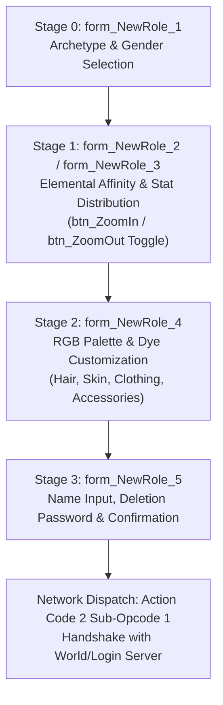

# Technical Specification 33: Character Creation, Appearance Engine, and Palette Customization

## 1. System Overview & Delphi Unit Hierarchy

The character creation pipeline in Wonderland Online is governed by the compilation unit `ft_role_rgb_tool_Type.pas` and companion unit `CH_NewRole.pas`. The engine implements a state-driven 5-stage character generator that transitions across five specialized VCL form panels:



The subsystem maintains two internal entity staging instances instantiated at `param_1 + 0xc4` and `param_1 + 200` via entity allocator `FUN_0042aca0`:
- Primary preview actor (`*(param_1 + 0xc4)`): Configured with motion state `0x121 = 4` (idle stance) and rendered dynamically at center viewport coordinates `(local_18 + (Width >> 1) - 2, local_14 + Height - 8)`.
- Secondary mirror actor (`*(param_1 + 200)`): Configured with motion state `0x121 = 0` for head/bust portrait generation.

---

## 2. Stage-by-Stage Form Pipeline

### 2.1 Stage 0: Archetype Selection (`form_NewRole_1`)
- **VCL Form Hook:** Instantiated via `FUN_0047885c(PTR_DAT_004c8a94, "form_NewRole_1")`.
- **Character Archetype Matrix:** The client provides 14 distinct character archetypes (7 male, 7 female):
  - Daniel, Kurotsuchi, Sam, Sid, Betty, Nina, Maria, Jessica, Vanessa, Clive, Bob, Alice, etc.
  - Archetype ID is written to `*(actor + 0x08)` and determines base sprite resource offsets:
    - Base offset 1000 (`local_46 = 1000`, `local_44 = 0`)
    - Base offset 2000 (`local_46 = 2000`, `local_44 = 100`)
    - Base offset 3000 (`local_46 = 3000`, `local_44 = 100`)
    - Base offset 4000 (`local_46 = 4000`, `local_44 = 100`)
    - Base offset 5000 (`local_46 = 5000`, `local_44 = 100`)
- **Subroutine Address:** `FUN_00271e8c` when `*(param_1 + 0x1ec) == 0`.

### 2.2 Stage 1: Element Alignment & Stat Allocation (`form_NewRole_2` / `form_NewRole_3`)
- **VCL Form Hooks:**
  - Standard View: `form_NewRole_2` (full-body view with attribute allocation dials).
  - Portrait Zoom View: `form_NewRole_3` (close-up portrait focus).
- **Zoom Toggle Mechanism (`FUN_002725f8`):**
  - Toggled via `*(byte *)(param_1 + 0x1f0) ^= 1`.
  - When active (1): switches form target to `form_NewRole_3` and toggles button texture to `"btn_ZoomOut"`.
  - When inactive (0): reverts form target to `form_NewRole_2` and restores button texture to `"btn_ZoomIn"`.
- **Elemental Affinities (`FUN_002724b4`):**
  - Five elemental affinities selectable via 5-state radio selector:
    1. Earth (地 - High DEF/CON, Earth protection)
    2. Water (水 - High Max SP/WIS, Healing & Revival)
    3. Fire (火 - High ATK/STR, Burst DPS)
    4. Wind (風 - High SPD/AGI, Fast turn order)
    5. Neutral/Special (Internal developmental index)
- **Initial Stat Distribution Budget (`FUN_0027256c`):**
  - Base stat allocation points: `*(undefined1 *)(param_1 + 0x1c4) = 6` (player distributes 6 free points).
  - Attribute allocation array at `param_1 + 0x1c6` through `param_1 + 0x1cb`:
    - `0x1c6`: STR (Strength - Melee Attack)
    - `0x1c7`: CON (Constitution - Physical Defense & Max HP)
    - `0x1c8`: INT (Intelligence - Magic Attack)
    - `0x1c9`: WIS (Wisdom - Magic Defense & Max SP)
    - `0x1ca`: AGI (Agility - Turn Initiative Speed)
  - Allocation validation: Sum of distributed stats must exactly consume the 6-point pool.

### 2.3 Stage 2: Palette Customization & RGB Tinting (`form_NewRole_4`)
- **VCL Form Hook:** `FUN_0047885c(PTR_DAT_004c8a94, "form_NewRole_4")`.
- **Customizable Color Zones:**
  1. Hair Color (`iVar1 + 0xd8`..`0xda`)
  2. Eye / Facial Tone (`iVar1 + 0xdb`..`0xdd`)
  3. Primary Outfit / Tunic (`iVar1 + 0xde`..`0xe0`)
  4. Secondary Outfit / Trims (`iVar1 + 0xe1`..`0xe3`)
  5. Boots & Accessories (`iVar1 + 0xed`..`0xef`)
- **Palette Index Encoding (`FUN_00273950` / `FUN_00271af8`):**
  - Each zone supports pre-indexed palette tints (Values 0 through 4).
  - Encoded into two 32-bit packed integers (`param_1[0x5c]` and `param_1[0x5d]`) using base-10 positional weighting:
    $$\text{PaletteTag}_1 = \sum_{k=0}^{8} \text{byte}[0xd5 + k] \times 10^{8-k}$$
    $$\text{PaletteTag}_2 = \sum_{k=0}^{8} \text{byte}[0xde + k] \times 10^{8-k}$$

### 2.4 Stage 3: Name Input, Security Password, and Deletion Code (`form_NewRole_5`)
- **VCL Form Hook:** `FUN_0047885c(PTR_DAT_004c8a94, "form_NewRole_5")`.
- **String Constraints (`FUN_00273710`):**
  - Character Name: Maximum 16 characters (or 8 multi-byte characters).
  - Deletion Password / Pin: Checked against length constraint:
    ```c
    iVar3 = FUN_0001412c(*(undefined4 *)(param_1[iVar2 + 0x73] + 0x1a0));
    if (10 < iVar3) {
      ShowSystemToast("Pwd and Del must be less 10", 2000);
      return;
    }
    ```
  - Both secondary password and character deletion PIN must strictly be $\le 10$ characters.

---

## 3. Network Wire Protocol: Action Code 2 Sub-Opcodes

Role creation and character selection are multiplexed on **Action Code 2** (`0x02`):

| Sub-Opcode | Direction | Description | Payload Structure |
|---|---|---|---|
| `0x01` | Client $\to$ Server | Character Slot Query | `[AC:1] [Sub:1]` |
| `0x02` | Server $\to$ Client | Character Slot Data Manifest | `[AC:1] [Sub:2] [SlotCount:1] { [Slot:1] [Name:16] [Level:2] [Element:1] [Job:1] [HeadID:2] [BodyID:2] [Colors:8] }*` |
| `0x04` | Client $\to$ Server | Character Selection / Enter Game | `[AC:1] [Sub:4] [SlotIndex:1]` |
| `0x05` | Client $\to$ Server | Character Creation Request | `[AC:1] [Sub:5] [SlotIndex:1] [Name:16] [Archetype:2] [Element:1] [STR:1] [CON:1] [INT:1] [WIS:1] [AGI:1] [Palette1:4] [Palette2:4] [DelPin:10]` |
| `0x06` | Server $\to$ Client | Creation Result Code | `[AC:1] [Sub:6] [Result:1]` (`0 = Success`, `1 = Name Taken`, `2 = Invalid Chars`, `3 = Slot Occupied`) |
| `0x07` | Client $\to$ Server | Character Deletion Request | `[AC:1] [Sub:7] [SlotIndex:1] [DelPin:10]` |

---

## 4. Subroutine Inventory & Memory Offsets

| Subroutine | RVA | Description |
|---|---|---|
| `FUN_002706e0` | `0x002706e0` | `Tform_NewRole` Constructor and actor staging allocator |
| `FUN_002707bc` | `0x002707bc` | Composite avatar preview rendering pipeline |
| `FUN_00271af8` | `0x00271af8` | Palette color swatch index switcher |
| `FUN_00271d50` | `0x00271d50` | Reset character creation state and restore default palettes |
| `FUN_00271dc4` | `0x00271dc4` | Archetype selector and model mesh binder |
| `FUN_00271e8c` | `0x00271e8c` | Master stage coordinator (`form_NewRole_1` $\to$ `form_NewRole_5`) |
| `FUN_002724b4` | `0x002724b4` | Elemental affinity radio selector (Earth/Water/Fire/Wind) |
| `FUN_00272520` | `0x00272520` | Base stat increment/decrement arbitrator |
| `FUN_0027256c` | `0x0027256c` | Initialize stat pool (sets 6 allocatable bonus points) |
| `FUN_002725f8` | `0x002725f8` | Zoom In / Zoom Out toggle between `form_NewRole_2` and `form_NewRole_3` |
| `FUN_002726e8` | `0x002726e8` | Advance character slot index |
| `FUN_0027e2c4` | `0x0027e2c4` | Login session role selection handler and character packet dispatcher |

---

## 5. Emulator Implementation Guidelines

1. **Strict Stat Total Verification:**
   - Server must reject any creation packet where:
     $$\text{STR} + \text{CON} + \text{INT} + \text{WIS} + \text{AGI} \ne 6$$
   - All individual attributes must be $\ge 0$.
2. **Name Sanitization:**
   - Name must be trimmed, checked against banned word lists, and restricted to printable characters without control codes (`0x00`..`0x1F`).
3. **Palette Tag Preservation:**
   - Both `PaletteTag1` and `PaletteTag2` must be stored as unsigned 32-bit integers in the `characters` database table and replicated back to other clients via Action Code 5 (`0x05`) broadcast upon entering a map.
