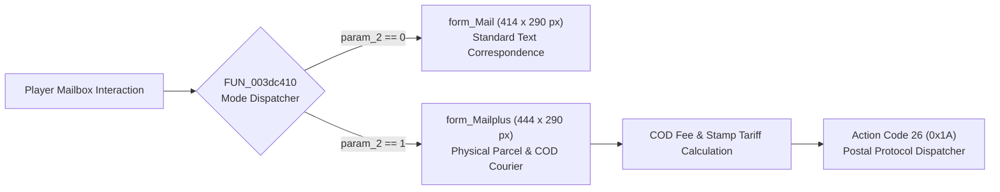

# Technical Specification 34: Postal Mail, Express Courier, and Parcel Delivery System

## 1. Subsystem Architecture & Delphi Package Units

In-game postal correspondence and physical package logistics in Wonderland Online are managed by two coupled Delphi compilation units:
- `AC_ICQ.pas`: Core messaging engine, recipient directory, and friend notification dispatch.
- `BK_Mail.pas`: Graphical mail interface, parcel slot container, cash-on-delivery (COD) calculations, and postal packet dispatchers.



---

## 2. Graphical Interface Forms & Geometric Layouts

The postal interface dynamically morphs its graphical canvas and control dimensions based on the active mode selected by `FUN_003dc410`:

### 2.1 Standard Text Mail (`form_Mail`)
- **Dimensions:** Width `0x19e` (414 pixels), Height `0x122` (290 pixels).
- **Controls & Coordinate Offsets:**
  - Close Button: Positioned at $(X=342, Y=24)$.
  - Subject Edit Box: Positioned at $X = 0x156$ (342 px).
  - Recipient Input: Positioned at $X = 0x156$ (342 px).
  - Message Text Body: 5 horizontal text rows configured with vertical step $0x3a$ (58 px) starting from $Y = 0x2c$ (44 px):
    $$Y_{\text{row } i} = i \times 58 + 44 \quad (i \in [0..4])$$
  - Attachment Slots: Explicitly hidden via `FUN_00480670(param_1[0x4a], 0)` and `FUN_00480670(param_1[0x4b], 0)`.
  - Action Code Identifier: Set to `param_1[0x7e] = 0`.

### 2.2 Parcel Express Courier (`form_Mailplus`)
- **Dimensions:** Width `0x1bc` (444 pixels), Height `0x122` (290 pixels).
- **Controls & Coordinate Offsets:**
  - Action Code Identifier: Set to `param_1[0x7e] = 0x1a` (Decimal 26).
  - Expanded Width Canvas: Expanded by 30 pixels horizontally to accommodate package slots.
  - Attachment Container: Enabled via `FUN_00480670(param_1[0x4a], 1)` and `FUN_00480670(param_1[0x4b], 1)`.
  - Item Attachment Grid: Single-item inventory drop target at coordinates $(X=193, Y=248)$ with item count spin-box.
  - Cash-on-Delivery (COD) Gold Input: Numeric entry field for requested gold remittance upon delivery.
  - Delivery Fee Stamp: Automatically calculated tariff deducted from sender's purse upon submission.

---

## 3. Subroutine Inventory & Internal Logic

| Subroutine | RVA | Description |
|---|---|---|
| `FUN_003dc064` | `0x003dc064` | Mailbox packet response receiver and unread mail counter |
| `FUN_003dc410` | `0x003dc410` | Dual-mode canvas morpher between `form_Mail` and `form_Mailplus` |
| `FUN_003dc614` | `0x003dc614` | Tab selector switching between Inbox, Sent, and Guild Mail views |
| `FUN_003dc6f8` | `0x003dc6f8` | Mail renderer and organization announcement formatter |
| `FUN_003de614` | `0x003de614` | Attachment serialization, parcel inventory binding, and throttle check |
| `FUN_003df274` | `0x003df274` | Recipient address resolution and online verification |
| `FUN_003df66c` | `0x003df66c` | Cash-on-Delivery (COD) numeric input verification |

### 3.1 Send Rate Limiting & Cooldown Engine
To prevent postal denial-of-service and packet spamming, subroutine `FUN_003de614` enforces a strict 6,000-millisecond (6.0 second) dispatch cooldown:
```c
iVar3 = FUN_00012d30(2000);
*(int *)(param_1 + COOLDOWN_OFFSET) = iVar3 + 6000; // Enforces 6.0 second wait
```
If a player attempts to send a consecutive mail before this window elapses, the client blocks transmission locally and displays an alert.

---

## 4. Network Wire Protocol: Action Code 26 (`0x1A`)

All postal communications operate under **Action Code 26** (`0x1A`):

### 4.1 Sub-Opcode Matrix

| Sub-Opcode | Direction | Description | Payload Structure |
|---|---|---|---|
| `0x01` | Client $\to$ Server | Query Mailbox List | `[AC:1] [Sub:1] [Page:1]` |
| `0x02` | Server $\to$ Client | Mailbox Summary List | `[AC:1] [Sub:2] [Count:1] { [MailID:4] [SenderID:4] [SenderName:16] [Date:4] [Type:1] [HasAttach:1] [SubjectLen:1] [Subject:N] }*` |
| `0x03` | Client $\to$ Server | Read Mail Body | `[AC:1] [Sub:3] [MailID:4]` |
| `0x04` | Server $\to$ Client | Mail Content Response | `[AC:1] [Sub:4] [MailID:4] [BodyLen:2] [Body:N] [ItemID:2] [ItemCount:2] [CODAmount:4]` |
| `0x05` | Client $\to$ Server | Send Text Mail | `[AC:1] [Sub:5] [RecipientName:16] [SubjectLen:1] [Subject:N] [BodyLen:2] [Body:N]` |
| `0x06` | Client $\to$ Server | Send Parcel / COD Mail | `[AC:1] [Sub:6] [RecipientName:16] [SubjectLen:1] [Subject:N] [BodyLen:2] [Body:N] [SlotIndex:1] [ItemCount:2] [CODGold:4]` |
| `0x07` | Client $\to$ Server | Claim Attachment | `[AC:1] [Sub:7] [MailID:4]` |
| `0x08` | Server $\to$ Client | Attachment Claim Result | `[AC:1] [Sub:8] [MailID:4] [Status:1]` (`0 = Success`, `1 = Inventory Full`, `2 = Not Enough Gold for COD`) |
| `0x09` | Client $\to$ Server | Delete Mail | `[AC:1] [Sub:9] [MailID:4]` |
| `0x0A` | Server $\to$ Client | New Mail Notification Icon | `[AC:1] [Sub:10] [UnreadCount:1]` |

---

## 5. Emulator Implementation Guidelines

1. **COD Remittance Safety:**
   - When a recipient claims a Cash-on-Delivery item, the server must verify the recipient has sufficient gold:
     $$\text{Gold}_{\text{recipient}} \ge \text{CODGold}$$
   - Deduct the gold from the recipient and credit it to the sender via an automated system return mail.
2. **Mailbox Capacity Caps:**
   - Inbox capacity is capped at 50 messages per character. Further incoming mails should return an inbox-full error code to the sender.
3. **Expiration & Storage Lifecycle:**
   - Unread mails expire after 30 days.
   - Read mails without attachments expire after 7 days.
   - Returned / unaccepted COD parcels are automatically routed back to the sender after 15 days.
