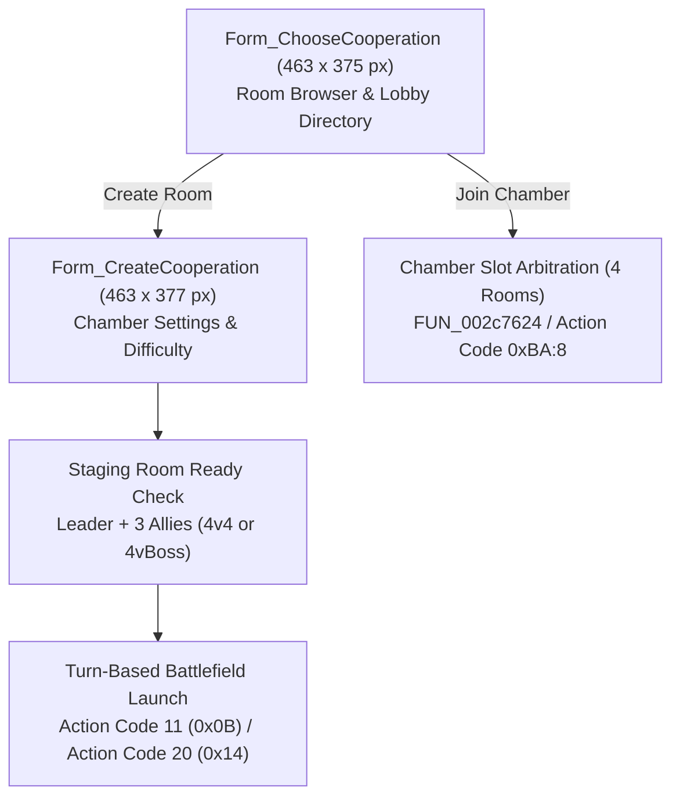

# Technical Specification 35: Turn-Based Co-op Battle Assembly and Chamber Lobby

## 1. System Overview & Delphi Compilation Units

The turn-based cooperative battle staging system in Wonderland Online is implemented in unit `IN_CooperateFight.pas` with runtime combat orchestration in `mCH_Fight.pas`. The system provides dedicated instance lobbies where multiple players organize into synchronized 4v4 or PvE cooperative raid squads prior to launching turn-based battlefield instances.



---

## 2. Graphical Interface Forms & Control Hierarchies

### 2.1 Cooperative Room Browser (`Form_ChooseCooperation`)
- **Dimensions:** Width `0x1cf` (463 pixels), Height `0x177` (375 pixels).
- **Controls & Component Array:**
  - `Btn_CooperationChoose`: Join selected cooperative battle room.
  - `Btn_CreateCooperation`: Spawn new room configuration dialog.
  - `Icon_CooperationList`: Tabulated header icon for active chambers.
  - `Btn_CooperationInfo`: Display dungeon instance rules, restrictions, and rewards.
  - `Btn_CooperationPlayer`: Inspect participant levels, elements, and gear.
  - `Btn_CooperationQuit`: Exit room browser.
- **Room Slot Directory (`FUN_002c7624`):**
  - Displays up to 4 concurrent room chambers per page:
    ```c
    iVar6 = 1;
    do {
      // Room leader comparison against local CharID:
      local_5 = *(int *)(room_ptr + 0x58 + iVar6 * 0xd) == *(int *)(LocalPlayer + 0x2344);
      // Player capacity ratio:
      FUN_0001a310("Players: %d/%d", &curr_players, &max_players);
      iVar6 = iVar6 + 1;
    } while (iVar6 != 5);
    ```

### 2.2 Room Creation Dialog (`Form_CreateCooperation`)
- **Dimensions:** Width `0x1cf` (463 pixels), Height `0x179` (377 pixels).
- **Dynamic Centering Formula:**
  - Automatically centered horizontally and vertically on screen based on viewport resolution:
    $$X = \frac{\text{ViewportWidth} - 463}{2}, \quad Y = \frac{\text{ViewportHeight} - 377}{2}$$
- **Controls & Buttons:**
  - `Btn_Close_S_1`: Top-right corner close button ($18 \times 18$ px).
  - `btn_close_1` / `Btn_Cancel_1`: Cancel room creation and return to browser ($20 \times 56$ px).
  - `Btn_Create`: Confirm chamber parameters and broadcast creation request.
  - Room Password Checkbox & Input: Restrict entry to authorized allies.
  - Minimum Level Requirement Spinbox: Restrict lower-level participant entry.

### 2.3 Wagering & Stake Panel (`Form_Ante`)
- Configures gold / token wagers for cooperative challenge matches.

---

## 3. Subroutine Inventory & Reverse Engineered Logic

| Subroutine | RVA | Description |
|---|---|---|
| `FUN_002c75a4` | `0x002c75a4` | Page refresh dispatcher via Action Code `0xBA` Sub-Opcode 9 |
| `FUN_002c75e0` | `0x002c75e0` | Set current page index and maximum page count |
| `FUN_002c75f0` | `0x002c75f0` | Room join authorization check and request via Action Code `0xBA` Sub-Opcode 8 |
| `FUN_002c7624` | `0x002c7624` | 4-room slot state evaluator, title lookup, and player ratio formatter |
| `FUN_002c84ac` | `0x002c84ac` | Font rendering for chamber names, player counts, and status labels |
| `FUN_002c854c` | `0x002c854c` | Destructor and cleanup routine for cooperative form instances |
| `FUN_002c26f4` | `0x002c26f4` | Dungeon scenario ID resolver and metadata lookup |

---

## 4. Network Wire Protocol: Action Code 186 (`0xBA`) & Action Code 20 (`0x14`)

Cooperative matchmaking and lobby synchronization are multiplexed across **Action Code 186** (`0xBA`):

### 4.1 Action Code `0xBA` Sub-Opcode Matrix

| Sub-Opcode | Direction | Description | Payload Structure |
|---|---|---|---|
| `0x01` | Client $\to$ Server | Query Room Page | `[AC:1] [Sub:1] [Page:1]` |
| `0x02` | Server $\to$ Client | Room Page Manifest | `[AC:1] [Sub:2] [Page:1] [TotalPages:1] [RoomCount:1] { [RoomID:4] [LeaderID:4] [LeaderName:16] [ScenarioID:2] [CurrPlayers:1] [MaxPlayers:1] [HasPassword:1] }*` |
| `0x03` | Client $\to$ Server | Create Room Request | `[AC:1] [Sub:3] [ScenarioID:2] [MinLevel:2] [PasswordLen:1] [Password:N]` |
| `0x04` | Server $\to$ Client | Create Room Response | `[AC:1] [Sub:4] [Status:1] [RoomID:4]` (`0 = Success`, `1 = Already In Room`, `2 = Invalid Level`) |
| `0x08` | Client $\to$ Server | Join Room Request | `[AC:1] [Sub:8] [RoomID:4] [PasswordLen:1] [Password:N]` |
| `0x09` | Server $\to$ Client | Room Member Sync | `[AC:1] [Sub:9] [RoomID:4] [MemberCount:1] { [Slot:1] [CharID:4] [Name:16] [Level:2] [Element:1] [Job:1] [IsReady:1] }*` |
| `0x0A` | Client $\to$ Server | Toggle Ready State | `[AC:1] [Sub:10] [IsReady:1]` |
| `0x0B` | Client $\to$ Server | Leave Room Request | `[AC:1] [Sub:11] [RoomID:4]` |
| `0x0C` | Client $\to$ Server | Start Battle (Leader) | `[AC:1] [Sub:12] [RoomID:4]` |
| `0x0D` | Server $\to$ Client | Battle Transition Signal | `[AC:1] [Sub:13] [BattlefieldID:4] [EncounterData:N]` |

### 4.2 Duel & Arbitration Handshake: Action Code 20 (`0x14`)
When cooperative battles involve competitive player teams (4v4 PvP Arena), turn arbitration and challenge acceptance are mediated via Action Code 20:
- `AC 20:1`: Challenge request issued to opponent leader.
- `AC 20:2`: Challenge accepted / rejected response.
- `AC 20:9`: Arbitration initialization packet (`FUN_002d6ad8(..., 0x14, 9, 0)`).

---

## 5. Emulator Implementation Guidelines

1. **Party & Room Membership Exclusivity:**
   - A player cannot create or join a cooperative chamber if already committed to another active party, trade session, or combat encounter.
2. **Readiness Lock:**
   - The room leader cannot trigger Battle Start (`Sub-Opcode 0x0C`) until all other participating members have toggled their ready status to `1`.
3. **Turn Arbitration & Grid Staging:**
   - Upon battle commencement, players in Team A occupy grid slots 1 through 4 (front and back rows), while opponents/bosses occupy Team B slots 5 through 8.
   - Initiative speed is evaluated dynamically per character based on total Agility plus equipment modifiers.
