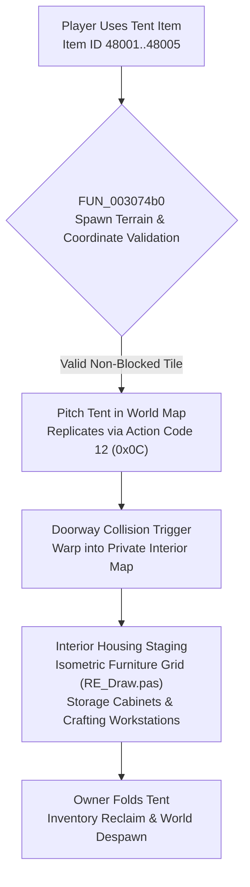

# Technical Specification 36: Tent Housing, Camping Deployment, and Furniture Layout

## 1. System Overview & Delphi Compilation Units

The private player housing and tent sanctuary subsystem in Wonderland Online is managed by the housing suite in Delphi:
- `RE_Home.pas`: Master tent housing lifecycle, tent pitching/folding logic, interior boundary validation, and visitation permissions.
- `RE_Draw.pas`: Isometric furniture rendering, sprite z-sorting, and decorative fixture placement.
- `lRE_EveStruct.pas`: Housing object serialization, storage container inventories, and workstation tool integration.

---

## 2. World Pitching & Deployment Mechanics

Subroutine `FUN_003074b0` (RVA `0x003074b0`) executes the tent deployment protocol when a player activates a tent camping item:

### 2.1 Coordinate & State Storage
Upon successful placement, the client records the world tent instance state in entity memory:
- `*(puVar2 + 0x7122)`: Tent Model / Aesthetic Skin ID (`param_1 + 8`).
- `*(puVar2 + 0x7124)`: World Placement X Coordinate (`param_1 + 0x0c`).
- `*(puVar2 + 0x7128)`: World Placement Y Coordinate (`param_1 + 0x10`).
- `*(puVar2 + 0x712c)`: Directional Facing Orientation (`0..7`).
- `*(puVar2 + 0x712d)`: Owner Character Name (20-byte string buffer).
- `*(puVar2 + 0x7330)`: Public Visitation Permission Flag (`0 = Open to Public`, `1 = Friends Only`, `2 = Locked/Private`).

### 2.2 Scene Transition & Ambient Switch
Entering a pitched tent triggers a complete interior state transition:
1. Closes conflicting world UI panels (Quest log, mini-map GPS, radar, party list).
2. Clears weather particles (Snow/Rain simulation paused via `FUN_0034f0f8`).
3. Switches ambient audio and BGM to interior cozy theme via `FUN_001211bc(PTR_DAT_004c9024, PTR_DAT_004c864c)`.
4. Resets player speed and dismounts active ground/air vehicles.

---

## 3. Interior Spatial Grid & Furniture Layout (`RE_Draw.pas`)

The tent interior uses an isometric diamond tile grid with coordinate axes $(U, V)$ rotated 45 degrees:

### 3.1 Tile Grid Dimensions
- **Floor 1 (Standard):** $12 \times 12$ isometric tiles (Upgradable to $16 \times 16$).
- **Floor 2 (Attic Extension):** $12 \times 12$ tiles unlocked via Attic Renovation Scroll.
- **Basement (Underground Extension):** $12 \times 12$ tiles unlocked via Basement Scroll.

### 3.2 Housing Fixture Classes & Functionality
Objects placed in the tent are categorized into four operational classes:
1. **Decorative Furnishings:** Chairs, tables, carpets, wall clocks, and wallpaper/flooring swatches.
2. **Storage Containers:** Wooden Cabinets, Steel Safes, Wardrobes, and Tool Chests providing secondary vault storage.
3. **Rest & Vitality Regeneration:** Beds and Bathtubs (accelerate HP/SP passive recovery rates by 200%..500%).
4. **Manufacturing Workstations:**
   - Workbench (Basic crafting)
   - Alchemy Oven (Synthesis and smelting)
   - Loom (Textile spinning)
   - Precision Lathe (Machinery parts and vehicle engine parts)
   - High-Temperature Kiln (Ceramics, glass, and refractory alloys)

---

## 4. Network Wire Protocol: Action Code 12 (`0x0C`)

Tent deployment and housing interaction operate on **Action Code 12** (`0x0C`):

### 4.1 Sub-Opcode Matrix

| Sub-Opcode | Direction | Description | Payload Structure |
|---|---|---|---|
| `0x01` | Client $\to$ Server | Pitch Tent Request | `[AC:1] [Sub:1] [X:4] [Y:4] [Heading:1] [TentSkinID:2]` |
| `0x02` | Server $\to$ Client | World Tent Spawn Broadcast | `[AC:1] [Sub:2] [OwnerID:4] [OwnerName:16] [X:4] [Y:4] [Heading:1] [TentSkinID:2]` |
| `0x03` | Client $\to$ Server | Fold / Retract Tent | `[AC:1] [Sub:3]` |
| `0x04` | Server $\to$ Client | World Tent Despawn | `[AC:1] [Sub:4] [OwnerID:4]` |
| `0x05` | Client $\to$ Server | Enter Tent Interior | `[AC:1] [Sub:5] [OwnerID:4]` |
| `0x06` | Server $\to$ Client | Interior Layout Manifest | `[AC:1] [Sub:6] [Floor:1] [ItemCount:2] { [SlotID:2] [ItemID:2] [TileU:1] [TileV:1] [Heading:1] [CustomData:4] }*` |
| `0x07` | Client $\to$ Server | Place Furniture Object | `[AC:1] [Sub:7] [Floor:1] [InvSlot:1] [TileU:1] [TileV:1] [Heading:1]` |
| `0x08` | Client $\to$ Server | Reclaim / Move Furniture | `[AC:1] [Sub:8] [Floor:1] [SlotID:2]` |
| `0x09` | Client $\to$ Server | Set Tent Visitation Rules | `[AC:1] [Sub:9] [AccessLevel:1]` (`0 = Public`, `1 = Friends`, `2 = Locked`) |
| `0x0A` | Server $\to$ Client | Visitation Denial Alert | `[AC:1] [Sub:10] [Reason:1]` (`1 = Locked`, `2 = Owner Offline`) |

---

## 5. Subroutine Inventory & Memory Offsets

| Subroutine | RVA | Description |
|---|---|---|
| `FUN_003074b0` | `0x003074b0` | Primary tent pitch coordinator and world instance spawn validator |
| `FUN_0031e734` | `0x0031e734` | Housing instance memory allocator and spatial object list binder |
| `FUN_00496450` | `0x00496450` | Tent exterior sprite model indexer |
| `FUN_0049ed0c` | `0x0049ed0c` | Interior floor elevation and doorway hitbox detector |
| `FUN_0049ed20` | `0x0049ed20` | Furniture collision bounding box validator |
| `FUN_0032e6cc` | `0x0032e6cc` | Furniture placement rendering and shadow footprint projector |

---

## 6. Emulator Implementation Guidelines

1. **Terrain Pitching Constraints:**
   - Server must enforce terrain rules before allowing a tent pitch:
     - Pitching is disallowed inside towns, dungeons, narrow staircases, or within 50 pixels of another player's tent.
     - Target tile must not have collision/blocking flags.
2. **Persistence & Database Storage:**
   - Furniture coordinates $(U, V)$, rotations, and contained storage inventories must be serialized in a `tent_furnitures` database table.
   - When a tent is folded while containing unpacked furniture, items remain saved in the interior layout table and are restored seamlessly when re-pitched.
3. **Disconnection Recovery:**
   - If an owner disconnects while inside their tent, their session state is recorded as interior. Upon reconnecting, the character logs into their private tent interior.
   - If visitors are inside a tent and the owner folds the tent or disconnects, all visitors are safely ejected to the world map at the tent's entrance coordinates.
