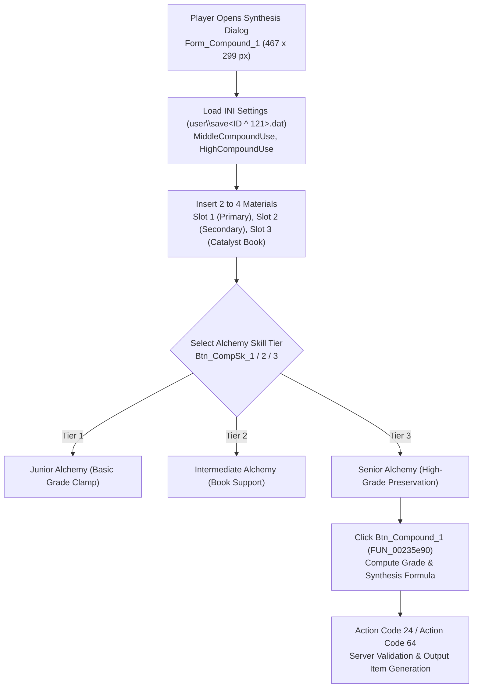

# Technical Specification 37: Item Compound, Alchemy Synthesis, and Grade Formulas

## 1. Subsystem Overview & Compilation Hierarchy

Item compounding (alchemy synthesis) is one of the foundational production systems in Wonderland Online, driven by compilation unit `jo_MixItem.pas` in conjunction with material taxonomy `FUN_0049f998` and save profile manager `AC_Save.pas`.



---

## 2. Graphical Interface: `Form_Compound_1`

The synthesis workbench is implemented as an animated VCL form:
- **Dimensions:** Width `0x1d3` (467 pixels), Height 299 pixels.
- **Centering Calculation (`FUN_0023535d`):**
  $$X = \frac{\text{ViewportWidth} - 467}{2}, \quad Y = \frac{\text{ViewportHeight} - 299}{2}$$

### 2.1 Interface Controls & Visual Assets
- `Btn_Close_S_1`: Corner exit button ($18 \times 18$ px).
- `Btn_Close_1`: Bottom dismissal button ($20 \times 56$ px).
- `Btn_CompSk_1`, `Btn_CompSk_2`, `Btn_CompSk_3`: Radio tabs for active alchemy tier:
  1. Junior Alchemy (`Btn_CompSk_1`)
  2. Intermediate Alchemy (`Btn_CompSk_2`)
  3. Senior Alchemy (`Btn_CompSk_3`)
- `btn_UnCheck_1`: Checkbox toggle for `"Use Junior Alchemy"` (`param_1 + 0x244`).
- `Icon_RoleSelectFrame`: Active participant highlight border.
- `Icon_UseCompoundSkill`: Visual glow indicating catalyst activation.
- `Btn_Compound_1`: Synthesis execution trigger at $(X = \text{Width}/2 - 10 - 56, Y = 20)$.

---

## 3. Configuration Persistence & Client Save State

Player synthesis toggles are automatically serialized into the encrypted player save profile `user\save<CharID ^ 0x79>.dat` (`user\save<CharID ^ 121>.dat`) via INI writer routines:
```c
FUN_000237b8(ini_handle, "MiddleCompoundUse", val_middle);
FUN_000237b8(ini_handle, "HighCompoundUse", val_high);
```
- When `MiddleCompoundUse = 1`: The client automatically engages Intermediate Alchemy algorithms when 3 items are present.
- When `HighCompoundUse = 1`: The client prioritizes Senior Alchemy and allows Alchemy Book IV catalysts.

---

## 4. Synthesis Formulas, Grades, and Material Compatibility

### 4.1 Item Grade Calculation Formula
Every equipable item and raw material possesses a defined **Item Grade** (Rank 1 through 50+).
When two items $A$ and $B$ are compounded with grades $G_A$ and $G_B$:

$$\text{BaseGrade} = \left\lfloor \frac{G_A + G_B}{2} \right\rfloor$$

### 4.2 Alchemy Tier Modifiers & Grade Deltas ($\Delta G$)
The maximum grade jump is strictly bounded by the character's active Alchemy skill and catalyst book:

| Alchemy Skill Tier | Skill ID | Base Grade Delta ($\Delta G$) | Alchemy Book Effect | Failure Rate Penalty |
|---|---|---|---|---|
| **Primary (No Skill)** | None | $-3 \le \Delta G \le +1$ | Cannot use books | Highest (reverts to raw clay/ash) |
| **Junior Alchemy** | `0x3E7E` (15998) | $-2 \le \Delta G \le +2$ | Book I (+1 Grade) | Moderate failure reduction |
| **Intermediate Alchemy** | `0x3E7F` (15999) | $-1 \le \Delta G \le +3$ | Book I, II (+1..+2) | Low failure rate |
| **Senior Alchemy** | `0x3E80` (16000) | $0 \le \Delta G \le +4$ | Book I..IV (+1..+4) | Zero destruction on matching classes |

### 4.3 Material Compatibility Constraints (Document 25 Taxonomy)
Synthesis success depends on the material chemistry relationship defined in `FUN_0049f998`:
- **Matching Materials:** Compounding two items of the same category (e.g., Gold + Gold, Wood + Wood) guarantees output within that identical category.
- **Cross-Category Hybridization:**
  - Wood + Iron $\to$ Bows / Spears / Mechanical Parts
  - Copper + Tin $\to$ Bronze Equipment
  - Clay + Water $\to$ Pottery / Refractory Bricks
  - Flora + Fauna $\to$ Recovery Potions / Antidotes
- **Incompatible Pairs:** Attempting to combine chemically inert or volatile materials (e.g., Toxic Acid + High Explosive without stabilizer) yields Trash / Slime (`Item ID 36001`).

---

## 5. Subroutine Inventory & Reverse Engineered Offsets

| Subroutine | RVA | Description |
|---|---|---|
| `FUN_0023535d` | `0x0023535d` | `Form_Compound_1` constructor and screen-centering layout |
| `FUN_00235e14` | `0x00235e14` | "Use Junior Alchemy" checkbox toggle handler |
| `FUN_00235e90` | `0x00235e90` | `Btn_Compound_1` click handler and INI state committer |
| `FUN_002378a8` | `0x002378a8` | Alchemy skill rank checker (Junior/Inter/Senior) |
| `FUN_00237b74` | `0x00237b74` | Slot item drop validator and catalyst compatibility inspector |
| `FUN_00237b94` | `0x00237b94` | Multi-item inventory payload unpacker |
| `FUN_00237d58` | `0x00237d58` | Clear all synthesis input slots and reset UI preview |
| `FUN_00237d7c` | `0x00237d7c` | Inventory right-click item insertion into synthesis grid |
| `FUN_00237dd8` | `0x00237dd8` | Uncheck / unlock inventory item selection flags |
| `FUN_00237e44` | `0x00237e44` | Render "Use Junior Alchemy" description and tooltips |
| `FUN_00237f54` | `0x00237f54` | Advanced Alchemy tier switcher and book slot activator |

---

## 6. Network Wire Protocol & Emulator Implementation

### 6.1 Compound Request Packet
When `Btn_Compound_1` executes, the client formats the compounding request:
- **Action Code:** `0x18` (Action Code 24) or `0x40` (Action Code 64 for Tent machines).
- **Sub-Opcode:** `0x02` (Execute Compound).
- **Payload Structure:**
  ```
  [AC:1] [Sub:1] [SkillTier:1] [SlotCount:1]
  { [InvSlot:1] [ItemID:2] [Count:2] }* (2..4 items)
  [CatalystBookSlot:1]
  ```

### 6.2 Emulator Execution Pipeline
1. Verify character owns all submitted items in specified inventory slots.
2. Validate character possesses the specified Alchemy skill tier.
3. Calculate output item candidate pool from database table `compound_recipes` matching:
   $$\text{Material}_1 \land \text{Material}_2 \land \text{BaseGrade} \pm \Delta G$$
4. Roll pseudo-random number against success rate curve.
5. Consume input materials from inventory (and catalyst book if equipped).
6. Insert resultant item into player inventory and emit synthesis sound effect `FUN_00121340`.
