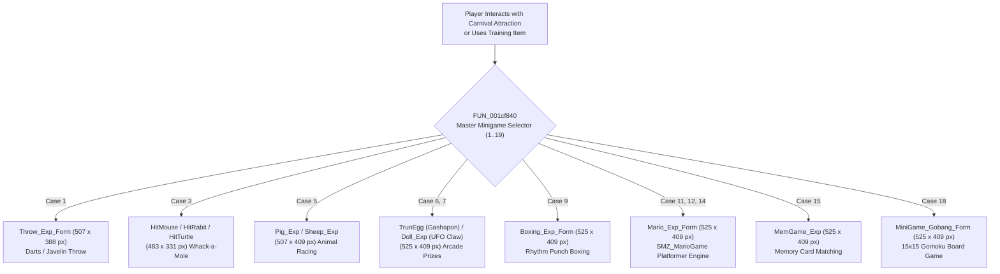

# Technical Specification 38: Carnival Minigame Training Matrix and Mario Platformer Engine

## 1. System Overview & Delphi Unit Hierarchy

The Carnival Amusement Park and stat/EXP training subsystem in Wonderland Online is driven by unit `SMZ_MarioGame.pas` and the master carnival form dispatcher `FUN_001cf840`. The client implements an extensive suite of 19 distinct minigames providing companion amity, experience points, and festival carnival tokens.



---

## 2. Complete 19-Minigame Training & Carnival Matrix

Subroutine `FUN_001cf840` evaluates parameter `param_2` (Minigame ID `1`..`0x13`) and instantiates the target VCL form:

| Case ID | Form Name | Geometry (W x H) | Minigame Type | Gameplay Description |
|---|---|---|---|---|
| `0x01` | `Throw_Exp_Form` | $507 \times 388$ px | Javelin / Darts | Moving power meter aiming at bullseye targets |
| `0x02` | `MiniGame_Explan_Form` | $525 \times 409$ px | Tutorial Dialog | How-to-play instruction manual for carnival park |
| `0x03` | `HitMouse_Exp_Form` | $483 \times 331$ px | Whack-a-Mole | Hammering moles popping out of 9 holes (`cVar1 == 0`) |
| `0x03` | `HitRabit_Exp_Form` | $483 \times 331$ px | Whack-a-Rabbit | Easter event rabbit hammering variant (`cVar1 == 1`) |
| `0x03` | `HitTurtle_Exp_Form` | $483 \times 331$ px | Whack-a-Turtle | Underwater turtle tapping variant (`cVar1 == 2`) |
| `0x04` | `Hunt_Exp_Form` | $483 \times 345$ px | Wilderness Hunting | Bow & arrow targeting wild boars and fowl |
| `0x05` | `Pig_Exp_Form` | $507 \times 409$ px | Pig Racing | Obstacle hurdle steeplechase racing |
| `0x05` | `Sheep_Exp_Form` | $507 \times 409$ px | Sheep Herding | Time-attack flock penning minigame |
| `0x06` | `TrunEgg_Exp_Form` | $525 \times 409$ px | Gashapon Capsule | Turning crank mechanism dropping surprise eggs |
| `0x07` | `Doll_Exp_Form` | $525 \times 409$ px | UFO Claw Crane | 2-axis crane claw dropping on plush dolls |
| `0x08` | `Slotmach_Exp_Form` | $525 \times 409$ px | Casino Slot Tier 1 | 3-reel fruit slot machine with stop buttons |
| `0x09` | `Boxing_Exp_Form` | $525 \times 409$ px | Rhythm Punch | Timing punches against oscillating strength bar |
| `0x0A` | `Slotmach_Exp_Form` | $525 \times 409$ px | Casino Slot Tier 2 | Advanced 5-reel gold coin slot machine |
| `0x0B` | `Mario_Exp_Form` | $525 \times 409$ px | Platformer Stage 1 | Side-scrolling obstacle jump (Beginner) |
| `0x0C` | `Mario_Exp_Form` | $525 \times 409$ px | Platformer Stage 2 | Side-scrolling obstacle jump (Intermediate) |
| `0x0D` | `MiniGame_Lucky_Form` | $525 \times 409$ px | Wheel of Fortune | Rotating carnival prize wheel with ticker pointer |
| `0x0E` | `Mario_Exp_Form` | $525 \times 409$ px | Platformer Stage 3 | Side-scrolling obstacle jump (Expert) |
| `0x0F` | `MemGame_Exp` | $525 \times 409$ px | Memory Match | 16-card flipper finding matching item pairs |
| `0x10` | `MiniGame_Poke_Form` | $525 \times 409$ px | Balloon Pop | Dart shooting popping colored balloons |
| `0x11` | `MiniGame_Pumpkin_Form`| $525 \times 409$ px | Pumpkin Catch | Halloween event falling pumpkin collection basket |
| `0x12` | `MiniGame_Gobang_Form` | $525 \times 409$ px | Gobang Chess | Turn-based 15x15 Gomoku five-in-a-row board |
| `0x13` | `Slotmach_Exp_Form` | $525 \times 409$ px | Casino Slot Tier 3 | High-roller VIP slot machine with jackpot payouts |

---

## 3. Deep Decompilation: The Mario Platformer Engine (`SMZ_MarioGame.pas`)

The Mario minigame (`FUN_0014596c`, RVA `0x0014596c`) is a fully functional 2D side-scrolling physics platformer embedded directly inside the client engine:

### 3.1 Physics & World Terrain Layout
- **World Ground Map:** Loaded via asset string `"MarioGround"` (`FUN_00479a24`), bounding dimensions $800 \times 600$ pixels.
- **Three Platform Tiers:**
  - High Platform: `"Mario_Up"` located at $(X=420, Y=70)$, width 15 px, height 70 px.
  - Middle Platform: `"Mario_Mid"` located at $(X=420, Y=70)$, width 15 px, height 70 px.
  - Bottom Platform: `"Mario_Buttom"` located at $(X=420, Y=70)$, width 15 px, height 70 px.
- **Goal / Bingo Collectibles:**
  - Primary Goal Marker: `"Mario_Bingo"` located at $(X=210, Y=210)$, scale $1 \times 210$.
  - Secondary Goal Marker: `"Mario_Bingo"` located at $(X=210, Y=70)$, scale $1 \times 70$.
  - Tertiary Goal Marker: `"Mario_Bingo"` located at $(X=210, Y=105)$, scale $1 \times 105$.
- **Gravity & Physics Clock:**
  - Physics tick interval configured at 1,000 ms per step:
    ```c
    *(undefined4 *)(param_1 + 0xc0) = 1000; // 1.0 second tick frequency
    ```
  - Upward jump impulse: Accelerates player entity vertically along parabolic arc.
  - Collision AABB test: Checks if character footprint coordinates overlap platform bounds or fall into the death abyss.

---

## 4. Network Wire Protocol: Action Code 34 (`0x22`) & Action Code 74 (`0x4A`)

Minigame sessions, scores, and rewards synchronize across two action codes:

### 4.1 Action Code 34 (`0x22`) - Mario & Solo Training Games
- **Sub-Opcode 1 (Session Start):** Client requests minigame session initialization (`FUN_002d6ad8(..., 0x22, 1)`).
- **Sub-Opcode 2 (Physics Sync / Score Report):**
  - Payload: `[AC:1] [Sub:1] [GameID:1] [Stage:1] [Score:4] [TimeElapsed:2]`
- **Sub-Opcode 3 (Reward Delivery):** Server grants EXP, Amity, or Carnival Tokens.

### 4.2 Action Code 74 (`0x4A`) - Competitive Minigames (Gobang, Boxing)
- **Sub-Opcode 1:** Invite opponent player to minigame duel.
- **Sub-Opcode 2:** Accept / reject challenge.
- **Sub-Opcode 5:** Move / Action synchronization (turn piece, punch timing).
- **Sub-Opcode 9:** Match end and forfeit arbitration.

---

## 5. Emulator Implementation Guidelines

1. **Anti-Cheat Validation:**
   - Server must enforce maximum theoretical score caps based on time elapsed:
     $$\text{MaxScore} \le \text{MaxPossiblePointsPerSecond} \times \text{SessionDuration}$$
   - Any report exceeding physics bounds must be flagged as a speedhack or packet injection.
2. **Carnival Token Rewards:**
   - Score translates into Carnival Tokens (`Item ID 49001`) at the rate of 1 token per 500 score points.
   - Companion pet amity increases by $+1$ for every completed minigame run up to amity 100.
