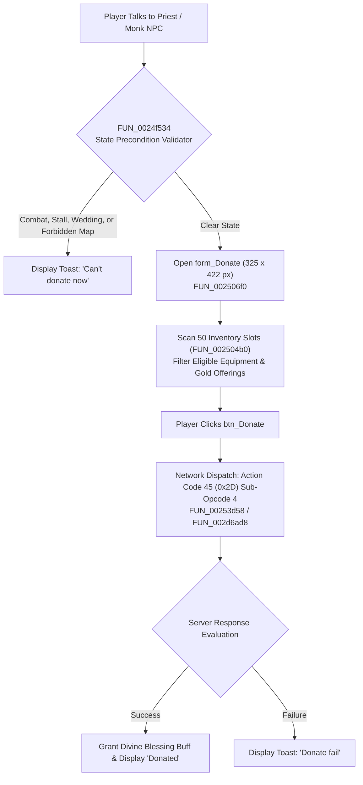

# Technical Specification 39: Church Charity Donation, Divine Blessings, and Karma Engine

## 1. Subsystem Architecture & Delphi Package Units

In Wonderland Online, church offerings, temple charity donations, and divine status blessings are implemented in Delphi unit `dSe_donate.pas` and UI module `BK_Donate.pas`. The system provides players a mechanism to sacrifice excess weapons, armor, and gold in exchange for divine alignment points (Karma), temporary protective buffs, and bad-luck mitigation.



---

## 2. Graphical Interface: `form_Donate`

The church donation window is constructed by subroutine `FUN_002506f0`:
- **Dimensions:** Width `0x145` (325 pixels), Height `0x1a6` (422 pixels).
- **Positioning:** Screen centered vertically and horizontally.

### 2.1 Interface Controls & Assets
- `icon_weaponry`: Header illustration showing offering altar.
- `icon_ItemGrids`: 50-slot grid overlay mapping player inventory bags.
- `Btn_Close_s_1`: Top-right exit button located at $(X = \text{Width} - 23, Y = 5)$, size $17 \times 17$ px.
- `Btn_Close_1`: Bottom cancel button located at $(X = (\text{Width} - 70)/2, Y = \text{Height} - 44)$, size $25 \times 70$ px.
- `btn_Donate`: Execution trigger button ($25 \times 70$ px) at coordinate offset $(X=110, Y=361)$.

---

## 3. Donation Precondition Engine (`FUN_0024f534`)

Before the donation dialog can open or accept offerings, subroutine `FUN_0024f534` enforces strict state validation:
```c
if (*(char *)(*(int *)PTR_DAT_004c9588 + 0x70e8) != '\0') return 0; // In battle/duel
if (*(char *)(*(int *)PTR_DAT_004c9918 + 0x1f16) != '\0') return 0; // In wedding/cupid
if (*(char *)(*(int *)PTR_DAT_004c9918 + 0x2231) != '\0') return 0; // In vending stall
if (*(short *)(*(int *)PTR_DAT_004c9918 + 0x235c) == 0x29cd) return 0; // Forbidden map (0x29CD)
if (*(char *)(*(int *)PTR_DAT_004c926c + 0x14) != '\0') return 0; // Modal conflict A
if (*(char *)(*(int *)PTR_DAT_004c9320 + 0x14) != '\0') return 0; // Modal conflict B
return 1; // Valid
```
If any condition fails, the client suppresses form opening and emits toast `"Can't donate now"`.

---

## 4. Inventory Filtering Algorithm (`FUN_002504b0`)

Subroutine `FUN_002504b0` scans all 50 slots of the player's primary bag (`iVar4 = 1..0x32`):
1. Reads item database record via `FUN_003e8db4(PTR_DAT_004c94f8, ItemID, &Record)`.
2. Checks item category `local_19c`:
   - Weapons (Swords, Bows, Spears, Guns, Wands)
   - Armor (Headgear, Body Armor, Gloves, Boots)
   - Church Offerings (Holy Water, Crosses, Relics, Incense)
   - Raw Gold Remittances
3. Rejects bound items (`Item[10] != 0`), quest essentials, and active rental items.
4. Updates slot display pointer: binds icon texture, quantity badge, and tooltip name (`FUN_003f1dfc`).

---

## 5. Network Wire Protocol: Action Code 45 (`0x2D`) Sub-Opcode 4

Donation commits are dispatched under **Action Code 45** (`0x2D`):

### 5.1 Request Packet Structure
Dispatched by `FUN_00253d58`:
```
[AC: 0x2D] [Sub: 0x04] [DonationType: 1] [SlotCount: 1]
{ [InvSlot: 1] [ItemID: 2] [ItemCount: 2] }*
[GoldAmount: 4]
```

### 5.2 Server Response Packet Structure
```
[AC: 0x2D] [Sub: 0x05] [Status: 1] [GrantedKarma: 2] [BlessingBuffID: 2] [BuffDurationSecs: 4]
```
- Status `0 = Success`: Client emits toast `"Donated"` via `FUN_004a487c` and plays chime audio.
- Status `1 = Fail`: Client emits toast `"Donate fail"`.

---

## 6. Divine Blessings & Karma Mechanics

Donations contribute toward three cumulative divine benefits:

1. **Karma Alignment Index ($K$):**
   - Increases based on total item grade and gold donated:
     $$\Delta K = \sum \text{ItemGrade} + \left\lfloor \frac{\text{Gold}}{1000} \right\rfloor$$
   - High Karma decreases death penalty EXP loss from $-5\%$ down to $-1\%$.
2. **Angelic Blessing Buff (1 Hour Duration):**
   - Max HP $+100$, Max SP $+50$.
   - $+5\%$ resistance against freeze, sleep, and seal debuffs.
3. **Bad-Luck Mitigation Counter:**
   - Elevates equipment forge success rates by $+2\%$ on the subsequent forging attempt.
