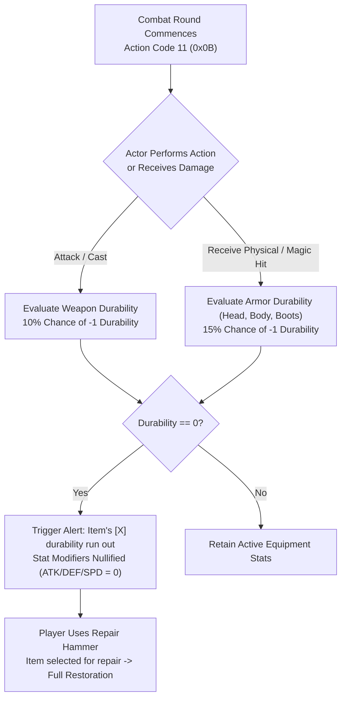

# Technical Specification 40: Equipment Durability, Combat Wear, and Repair Mechanics

## 1. System Overview & Delphi Compilation Units

The equipment degradation and restoration mechanics in Wonderland Online are managed by Delphi units:
- `oCY_Equip.pas`: Core equipment durability registers, combat turn wear evaluations, and zero-durability penalty states.
- `BK_Equip.pas`: Graphical equipment panel, repair cursor targeting, and tool selection.
- `CH_Traffic.pas`: Transportation vehicle wear and dockyard repair token calculations.



---

## 2. Equipment Slots & Memory Offsets

Player equipped items reside in the equipped gear array at `LocalPlayer + 0x27e8 + slot * 4`:

| Slot Index | Equipment Type | Memory Offset | Durability Offset | Combat Degradation Trigger |
|---|---|---|---|---|
| Slot 0 | Headgear / Helm | `+0x27e8` | `*(item + 0xe4)` | Hit received (Head/Critical) |
| Slot 1 | Body Armor / Robe | `+0x27ec` | `*(item + 0xe4)` | Physical or magical damage received |
| Slot 2 | Primary Weapon | `+0x27f0` | `*(item + 0xe4)` | Physical attack executed, skill cast |
| Slot 3 | Gloves / Bracers | `+0x27f4` | `*(item + 0xe4)` | Counterattack, blocking stance |
| Slot 4 | Boots / Shoes | `+0x27f8` | `*(item + 0xe4)` | Movement steps, flee attempt, evasion |
| Slot 5 | Accessory / Ring | `+0x27fc` | `*(item + 0xe4)` | Elemental magic cast |

---

## 3. Durability Loss Algorithms & Zero-Durability Penalties

During turn-based combat rounds (lines 411680 through 412270 of `aLogin_decompiled.c`), the engine tests whether active equipment durability decrements:

### 3.1 Degradation Probability Curve
$$\mathbb{P}(\text{Wear}) = \begin{cases}
0.10 & \text{for Weapons when executing physical/skill attacks} \\
0.15 & \text{for Armor when taking non-zero damage} \\
0.05 & \text{for Boots upon successful evasion}
\end{cases}$$

### 3.2 Durability Exhaustion Alert (`FUN_003f4721`)
When an item's durability reaches zero (`*(item + 0xe4) == 0`):
1. The client formats an urgent system announcement via `FUN_004a487c`:
   ```c
   FUN_003f1dfc(item_ptr, &item_name);
   FUN_000141ec(&buffer, "Item's [", item_name, "] durability run out");
   ShowSystemBroadcast(buffer);
   ```
2. **Stat Suppression Rule:** The item is **not** deleted or unequipped, but all attribute bonuses (ATK, DEF, MATK, MDEF, SPD) are suppressed to 0 until repaired.

---

## 4. Equipment Repair Pipeline & Tool Hierarchy

Players restore durability using consumable Repair Tools:

### 4.1 Repair Tool Classification

| Tool Name | Item ID | Max Target Rank | Durability Restored | Breakage Risk |
|---|---|---|---|---|
| **Wooden Mallet** | `36010` | Rank 1..10 | 100% | 5% chance of decreasing max durability by 1 |
| **Bronze Hammer** | `36011` | Rank 1..25 | 100% | 2% chance of decreasing max durability by 1 |
| **Silver Hammer** | `36012` | Rank 1..40 | 100% | 0% (Safe repair) |
| **Golden Hammer** | `36013` | Any Rank | 100% | 0% (Safe repair + restores lost max durability) |

### 4.2 Interactive Repair Workflow (Lines 191060 & 409843)
1. Player clicks repair tool; cursor changes to repair anvil crosshair (`"Item selected for repair"`).
2. Player targets an equipped item or bag item:
   - If `Item.Durability == Item.MaxDurability`: Emits alert `"Doesn't need repair"`.
   - If item is tagged non-repairable (`Item[10] & 0x04`): Emits alert `"Can't be repaired"`.
   - If valid: Deducts 1 repair hammer and resets `*(item + 0xe4) = *(item + 0xe8)`.

---

## 5. Transportation Vehicle Maintenance Mechanics

Vehicles (parsed from `TrafficSetting.txt`, Document 28) possess separate durability pools:
- **Repair NPC:** Shipyard / Dockyard Engineer NPC.
- **Repair Tariff Calculation (Line 208741):**
  $$\text{Cost} = \text{FixTrafficCost} \times (\text{MaxHP} - \text{CurrentHP})$$
  Client displays confirmation toast: `"Repairs cost: <Gold>"`.
- **Outcome States (Lines 208831 & 208842):**
  - Success: Emits `"Vehicle repaired"` and restores vehicle fuel/hull to 100%.
  - Failure: Emits `"Repairs failed"`.

---

## 6. Network Wire Protocol & Action Codes

Durability changes and repair executions operate on **Action Code 23** (`0x17`):

### 6.1 Sub-Opcode Matrix

| Sub-Opcode | Direction | Description | Payload Structure |
|---|---|---|---|
| `0x2A` | Server $\to$ Client | Durability Decrement Sync | `[AC: 0x17] [Sub: 0x2A] [SlotType: 1] [SlotIndex: 1] [NewDurability: 2]` |
| `0x2B` | Client $\to$ Server | Execute Item Repair | `[AC: 0x17] [Sub: 0x2B] [ToolBagSlot: 1] [TargetSlotType: 1] [TargetSlotIndex: 1]` |
| `0x2C` | Server $\to$ Client | Repair Result Code | `[AC: 0x17] [Sub: 0x2C] [TargetSlotType: 1] [TargetSlotIndex: 1] [NewDurability: 2] [Status: 1]` |
| `0x35` | Client $\to$ Server | Vehicle Repair Request | `[AC: 0x17] [Sub: 0x35] [VehicleID: 2]` |

---

## 7. Emulator Implementation Guidelines

1. **Combat Round Atomicity:**
   - Server must calculate and deduct equipment durability server-side after each battle turn.
   - Synchronize new durability via `Sub-Opcode 0x2A` immediately if durability drops to zero to update client HUD icons.
2. **Database Persistence:**
   - Field `durability` in table `character_equipments` must record the exact current value.
   - Forged equipment with potential upgrades (`+1`..`+12`) must preserve forge levels when repaired.
