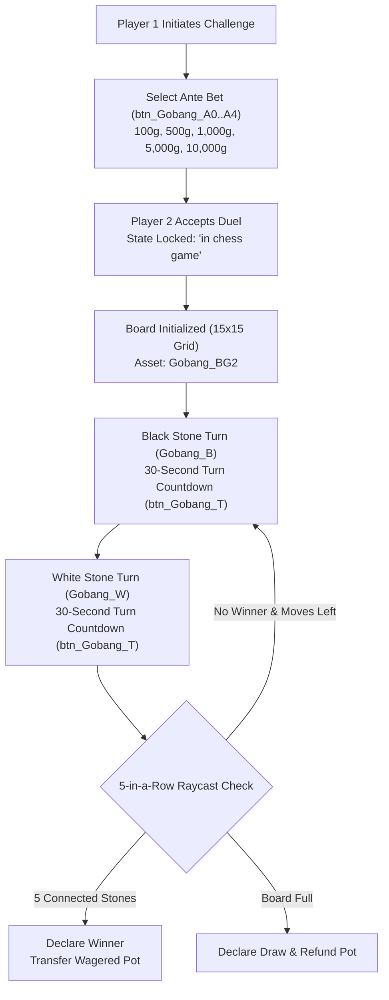

# Technical Specification 41: Gobang (Gomoku) Chess Board Game and Wager Engine

## 1. System Overview & Delphi Unit Architecture

The two-player competitive Gobang (Gomoku / 五子棋) board game in Wonderland Online is implemented in compilation unit `yRE_Chess.pas` and dialog unit `BK_Chess.pas`. The engine provides a complete turn-based 15x15 grid tabletop game with move timers, token/gold wagering, five-in-a-row raycast victory arbitration, and state-machine locking to prevent concurrent combat or trade while playing.

---

## 2. Graphical Interface Forms & Visual Assets

Subroutines starting at line 166064 of `aLogin_decompiled.c` assemble the Gobang tabletop window:
- **Form Identifier:** `MiniGame_Gobang_Form` ($525 \times 409$ pixels).
- **Core Visual Assets:**
  - `Gobang_BG2`: High-resolution $15 \times 15$ wooden grid gameboard texture.
  - `Gobang_B`: Black stone sprite with antialiased drop shadow.
  - `Gobang_W`: White stone sprite with reflective sheen.
- **Interactive Buttons & Controls:**
  - `btn_Gobang_Exit`: Leave/Forfeit button labeled `"Leave"` at $(X=633, Y=454)$.
  - `btn_Gobang_T`: Animated turn clock timer icon with radial countdown wipe.
  - Ante Selection Dials (`btn_Gobang_A0` through `btn_Gobang_A4`):
    - `btn_Gobang_A0`: 100 Gold coins
    - `btn_Gobang_A1`: 500 Gold coins
    - `btn_Gobang_A2`: 1,000 Gold coins
    - `btn_Gobang_A3`: 5,000 Gold coins
    - `btn_Gobang_A4`: 10,000 Gold coins

---

## 3. Grid Coordinates & Victory Raycast Algorithms

### 3.1 Board Grid Mapping
The board is represented as a $15 \times 15$ 2D matrix (225 total intersections):
$$\text{Grid}[x, y] \in \{0 = \text{Empty}, 1 = \text{Black}, 2 = \text{White}\} \quad (x, y \in [0..14])$$
Pixel coordinates on the `Gobang_BG2` canvas convert to grid indices via:
$$x = \left\lfloor \frac{P_x - X_{\text{origin}}}{\text{CellWidth}} + 0.5 \right\rfloor, \quad y = \left\lfloor \frac{P_y - Y_{\text{origin}}}{\text{CellHeight}} + 0.5 \right\rfloor$$

### 3.2 Four-Direction Raycast Verification
Upon every piece placement $(x_0, y_0)$, the engine executes a raycast probe along four directional vectors $\vec{v} \in \{(1, 0), (0, 1), (1, 1), (1, -1)\}$:
$$\text{Count}(\vec{v}) = 1 + \sum_{k=1}^{4} [\text{Grid}(x_0 + k\vec{v}_x, y_0 + k\vec{v}_y) == \text{Player}] + \sum_{k=1}^{4} [\text{Grid}(x_0 - k\vec{v}_x, y_0 - k\vec{v}_y) == \text{Player}]$$
If $\text{Count}(\vec{v}) \ge 5$, the active player is declared the winner immediately.

---

## 4. Player State Locking & Suspended Modes

While a Gobang match is active, the game client sets entity mutex flags to prevent gameplay desynchronization:
- **Match Active Flag:** `LocalPlayer + 0x22a4 = 1`.
  - Attempts by third parties to trade, duel, or initiate quests display system toast: `" in chess game"` (Line 242719).
- **Match Suspension Handling:**
  - If a player disconnects or enters map warp during a match, subroutine `FUN_0023f050` triggers alert `"Chess suspended"` (Line 242731).
  - An uncompleted match suspended due to disconnection awards the forfeited wager pot to the remaining online participant.

---

## 5. Network Wire Protocol: Action Code 74 (`0x4A`)

Gobang matchmaking and stone placement communicate under **Action Code 74** (`0x4A`):

### 5.1 Sub-Opcode Matrix

| Sub-Opcode | Direction | Description | Payload Structure |
|---|---|---|---|
| `0x01` | Client $\to$ Server | Send Gobang Duel Challenge | `[AC: 0x4A] [Sub: 0x01] [TargetID: 4] [AnteGold: 4]` |
| `0x02` | Server $\to$ Client | Challenge Notice to Target | `[AC: 0x4A] [Sub: 0x02] [ChallengerID: 4] [ChallengerName: 16] [AnteGold: 4]` |
| `0x03` | Client $\to$ Server | Accept / Reject Duel | `[AC: 0x4A] [Sub: 0x03] [ChallengerID: 4] [Accept: 1]` |
| `0x04` | Server $\to$ Client | Match Commenced Signal | `[AC: 0x4A] [Sub: 0x04] [MatchID: 4] [BlackPlayerID: 4] [WhitePlayerID: 4] [TotalPot: 4]` |
| `0x05` | Client $\to$ Server | Place Stone Move | `[AC: 0x4A] [Sub: 0x05] [MatchID: 4] [GridX: 1] [GridY: 1]` |
| `0x06` | Server $\to$ Client | Broadcast Stone Move | `[AC: 0x4A] [Sub: 0x06] [MatchID: 4] [Color: 1] [GridX: 1] [GridY: 1] [NextTurnColor: 1]` |
| `0x07` | Server $\to$ Client | Game Over & Winner Declaration | `[AC: 0x4A] [Sub: 0x07] [MatchID: 4] [WinnerColor: 1] [WinningLine: 10] [Prizepool: 4]` |
| `0x08` | Client $\to$ Server | Forfeit / Resign | `[AC: 0x4A] [Sub: 0x08] [MatchID: 4]` |

---

## 6. Emulator Implementation Guidelines

1. **Move Turn Timer Arbitration:**
   - Server must run a 30-second timer per move.
   - If a player fails to submit a move within 30 seconds, 1 warning strike is recorded. After 2 consecutive timeouts, the player automatically forfeits the match.
2. **Escrow Gold Locking:**
   - At the beginning of the match (`Sub-Opcode 0x04`), the server deducts `AnteGold` from both players and holds it in escrow.
   - Upon victory (`Sub-Opcode 0x07`), the server transfers `AnteGold * 2` (minus optional 5% town tax) to the winning player.
