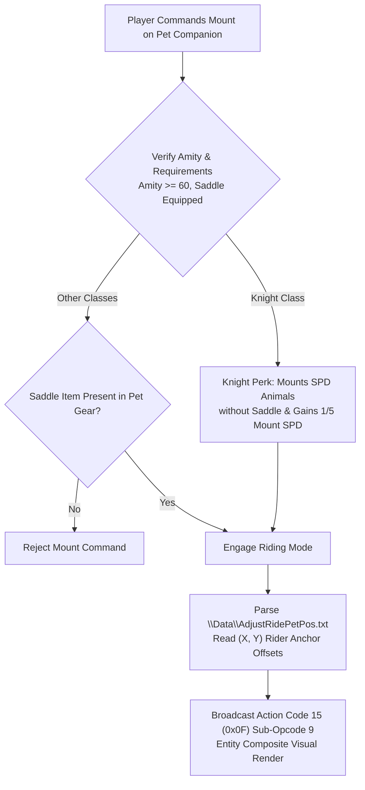

# Technical Specification 42: Companion Pet Riding, Mount Anchors, and Saddle Mechanics

## 1. System Overview & Delphi Compilation Units

The companion pet mount riding system in Wonderland Online is managed by Delphi units:
- `CH_RidePet.pas`: Core mounting state machine, rider anchor position calculator, and entity sprite composition.
- `nNJ_TrafficData.pas`: Movement speed bonuses, traversal medium flags, and party follow integration.
- Asset Parser `FUN_004284d5`: Configuration deserializer for data file `data\AdjustRidePetPos.txt`.

---

## 2. Mount Configuration File: `data\AdjustRidePetPos.txt`

Subroutine `FUN_004284d5` (RVA `0x004284d5`) parses the pet ride offset table:
- **File Path:** `\Data\AdjustRidePetPos.txt`.
- **Memory Buffer Allocation:** Stored in global array `LocalPlayer + 0x46988`.
- **Record Stride:** Exactly `0x204` (516) bytes per rideable pet species entry.

### 2.1 Keyword Schema & Tokens
The text parser scans for four primary structural directives:
1. `npccount <N>`: Declares total number of rideable NPC/monster species defined in the file.
2. `npcpic <NpcID>`: Binds the subsequent offset definitions to the monster species sprite ID.
3. Animation Stance Directives:
   - `stand`: Configures rider $(X, Y)$ offset tag `0x08` during stationary idle stance.
   - `walk`: Configures rider $(X, Y)$ offset tag `0x12` during 8-directional movement walk cycles.
   - `attack` / `hurt`: Configures rider anchor tag `0x2E` during combat encounters.
4. `fixedposonfirst <0|1>`: Flag indicating whether rider anchor coordinates lock rigidly to pet sprite root or bob dynamically with animation keyframes.

---

## 3. Class-Specific Perks & Saddle Mechanics

Mounting mechanics feature specialized class perks for the Knight ascension path (Lines 184515 & 184557 of `aLogin_decompiled.c`):

### 3.1 Knight Riding Privilege
- **Saddle Exemption:** Knights can mount all Agility/Speed animal pets without requiring a Saddle item equipped.
- **Speed Bonus Formula:** Knights receive an innate bonus equal to $20\%$ ($1/5$) of their active mount's base Agility/Speed:
  $$\text{SPD}_{\text{bonus}} = \left\lfloor \frac{\text{MountBaseSPD}}{5} \right\rfloor$$
- **Mount Speed Scaling:** Knights gain a passive $+10\%$ speed modifier (evaluated without equipment).

### 3.2 Non-Knight Requirements
- All other character classes require a **Saddle** (`Item ID 48010` or higher) equipped in the companion pet's accessory slot.
- Companion pet **Amity** must be $\ge 60$. If amity drops below 60 due to death or starvation, the pet refuses to be mounted.

---

## 4. Entity Memory & Visual Composite Staging

When riding a pet, the client alters the player's composite rendering pipeline:
- Player entity state register `*(actor + 0x121)` switches to `42` (`0x2A`: Mounted Stance).
- Entity heading direction is locked to the pet mount's heading direction.
- Player legs and lower torso sprites are hidden or substituted with riding sprite meshes.
- Rider sprite origin is offset by $(dX, dY)$ loaded from `AdjustRidePetPos.txt` for the current heading:
  $$X_{\text{render}} = X_{\text{pet}} + dX[\text{heading}], \quad Y_{\text{render}} = Y_{\text{pet}} + dY[\text{heading}]$$

---

## 5. Network Wire Protocol: Action Code 15 (`0x0F`)

Mounting, dismounting, and riding stance synchronization operate under **Action Code 15** (`0x0F`):

### 5.1 Sub-Opcode Matrix

| Sub-Opcode | Direction | Description | Payload Structure |
|---|---|---|---|
| `0x09` | Client $\to$ Server | Mount Companion Request | `[AC: 0x0F] [Sub: 0x09] [PetSlot: 1]` |
| `0x0A` | Server $\to$ Client | Mount Success Broadcast | `[AC: 0x0F] [Sub: 0x0A] [CharID: 4] [PetID: 2] [PetColor: 2]` |
| `0x0B` | Client $\to$ Server | Dismount Request | `[AC: 0x0F] [Sub: 0x0B]` |
| `0x0C` | Server $\to$ Client | Dismount Broadcast | `[AC: 0x0F] [Sub: 0x0C] [CharID: 4]` |
| `0x0D` | Server $\to$ Client | Mount Refusal Alert | `[AC: 0x0F] [Sub: 0x0D] [Reason: 1]` (`1 = Low Amity`, `2 = Missing Saddle`, `3 = Low Stamina`) |

---

## 6. Emulator Implementation Guidelines

1. **Stamina & Amity Tracking:**
   - Active mount riding consumes 1 point of companion pet Stamina per 60 seconds of continuous movement.
   - When Stamina reaches 0, the server forces an automatic dismount (`Sub-Opcode 0x0C`).
2. **Combat Entry Behavior:**
   - When entering a turn-based combat battlefield (Action Code 11), riding status is preserved. The player enters the battle grid mounted, retaining the mount's SPD initiative bonus on turn 1.
