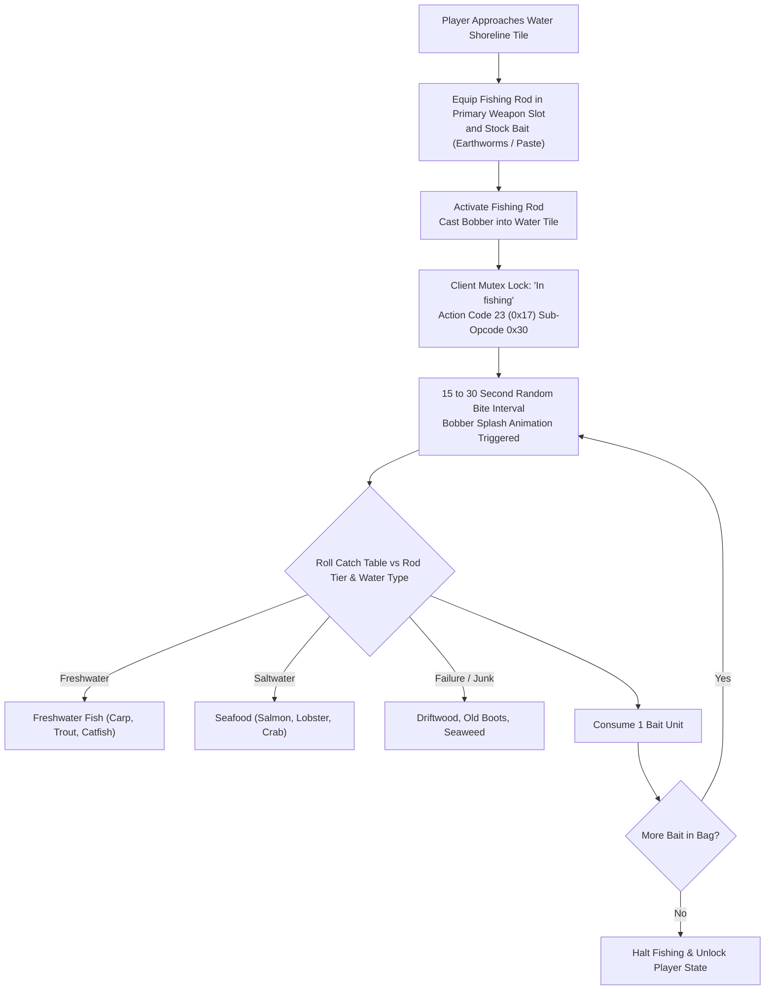

# Technical Specification 43: Fishing, Aquaculture, Bait Consumption, and Catch Tables

## 1. Subsystem Architecture & Delphi Package Units

The automatic fishing and aquaculture gathering subsystem in Wonderland Online is implemented in Delphi units:
- `CY_Fish.pas`: Primary fishing loop state machine, water shoreline collision raycast, bite intervals, and bait inventory tracking.
- `mWS_Operation.pas`: Interactive shoreline shop dialogs (`FormBuyFish` and `FormDelFish`) for fishmonger transactions.

---

## 2. Shoreline Vendor Forms: `FormBuyFish` & `FormDelFish`

In port settlements and shoreline docks (Welling Village, Kaohsiung, Kelan Docks), specialized aquaculture dialogs handle fish trading:
- **Dimensions:** Width `0xfc` (252 pixels), Height `0xf3` (243 pixels).
- **Form Identifiers:**
  - `FormBuyFish`: Fishmonger wholesale shop purchasing live bait, nets, and fish fries.
  - `FormDelFish`: Bulk fish sale merchant converting fresh catches into gold coins or fishmeal alchemical material.

---

## 3. Client State Locking & Mutex Constraints

While fishing is active, the game client sets entity state flag `LocalPlayer + 0x20b5 = 1` and rigorously suppresses conflicting game operations:
- **Action Suppression Matrix:**
  - Movement / Pathfinding: Blocks grid walk and emits toast `"Currently fishing"` (Line 146092).
  - Combat Challenge / Duel: Blocks PK challenge and emits `"Fishing, can't act"` (Line 205712).
  - Item Use / Inventory Swaps: Blocks item consumption and emits `"Fishing, can't use"` (Line 326520).
  - Equipment Repair: Blocks hammer use and emits `"Can't do while fishing"` (Line 409827).
  - Vehicle Mounting: Blocks vehicle summon and emits `"In fishing"` (Line 366592).

---

## 4. Tackle Tiers & Bait Consumption Mechanics

### 4.1 Fishing Rod Classifications

| Tackle Name | Item ID | Catch Interval | Junk Reduction | Special Attributes |
|---|---|---|---|---|
| **Bamboo Fishing Rod** | `36020` | $25 \sim 35$ sec | 0% | Baseline starter rod |
| **Wooden Fishing Rod** | `36021` | $20 \sim 30$ sec | $-10\%$ | Moderate durability |
| **Steel Fishing Rod** | `36022` | $15 \sim 25$ sec | $-25\%$ | Fast bite rate |
| **Automatic Fishing Pole** | `36023` | $12 \sim 20$ sec | $-40\%$ | Continuous background fishing |

### 4.2 Bait Types & Consumption Rates
Each catch attempt (successful or junk) consumes exactly 1 unit of bait from the primary bag:
1. **Earthworms** (`Item ID 36030`): Baseline bait; obtained via digging or soil gathering.
2. **Special Paste Bait** (`Item ID 36031`): Alchemy synthesized bait; $+15\%$ chance for rare fish.
3. **Red Worm Bait** (`Item ID 36032`): Premium bait; doubles the chance of landing rare alchemical seafood.

---

## 5. Catch Tables & Ecological Water Classes

Catch outcomes are partitioned by map water classification:

### 5.1 Freshwater Pools & Rivers (Welling, Kelan Lake, Kyoto Springs)
- Common ($60\%$): Small Carp, River Trout, Tilapia, Water Snails.
- Uncommon ($25\%$): Catfish, River Eel, Freshwater Shrimp.
- Rare ($10\%$): Giant Salmon, Golden Carp.
- Junk ($5\%$): Old Boots (`Item ID 36001`), Driftwood (`Item ID 36002`), Green Algae.

### 5.2 Deep Saltwater & Ocean Coasts (Kaohsiung Harbor, Ghost Isle, South Pole)
- Common ($50\%$): Mackerel, Cuttlefish, Sardine, Seaweed.
- Uncommon ($30\%$): Pacific Cod, Rock Lobster, Blue Crab.
- Rare ($15\%$): Bluefin Tuna, Sea Turtle Shell, Shark Fin.
- Sunken Treasure ($5\%$): Sunken Chest, Pearls, Rusty Iron Ore.

---

## 6. Network Wire Protocol: Action Code 23 (`0x17`)

Fishing lifecycle events communicate on **Action Code 23** (`0x17`):

### 6.1 Sub-Opcode Matrix

| Sub-Opcode | Direction | Description | Payload Structure |
|---|---|---|---|
| `0x30` | Client $\to$ Server | Cast Fishing Rod | `[AC: 0x17] [Sub: 0x30] [RodSlot: 1] [TargetTileX: 2] [TargetTileY: 2]` |
| `0x31` | Server $\to$ Client | Fishing State Broadcast | `[AC: 0x17] [Sub: 0x31] [CharID: 4] [IsFishing: 1] [WaterHeading: 1]` |
| `0x32` | Server $\to$ Client | Fish Hooked / Catch Event | `[AC: 0x17] [Sub: 0x32] [CaughtItemID: 2] [ItemCount: 1] [GainedEXP: 2]` |
| `0x33` | Client $\to$ Server | Stop Fishing / Retract Rod | `[AC: 0x17] [Sub: 0x33]` |
| `0x34` | Server $\to$ Client | Out of Bait Notification | `[AC: 0x17] [Sub: 0x34] [CharID: 4]` |

---

## 7. Emulator Implementation Guidelines

1. **Shoreline Tile Raycasting:**
   - Server must verify that $(TargetTileX, TargetTileY)$ is within 2 tiles of the player's position and carries a water/ocean terrain surface attribute.
2. **Inventory Space Safety:**
   - If a player lands a catch while their inventory is completely full (50/50 slots), the caught fish is automatically dropped onto the ground at the player's feet via Action Code 24 (`0x18`) ground spawn.
