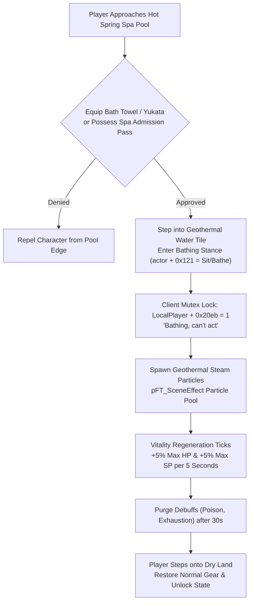

# Technical Specification 44: Hot Spring Bathing, Vitality Recovery, and Towel Mechanics

## 1. System Overview & Delphi Compilation Units

The hot spring bathing, geothermal spa, and vitality recovery engine in Wonderland Online is implemented in compilation unit `se_HotSpring.pas` with particle visual effects in `pFT_SceneEffect.pas`. The system provides public and private spa facilities where characters submerge into warm water to rapidly regenerate HP and SP, cure environmental fatigue, and socialize.

---

## 2. Geothermal Water Tile Triggers & Bathing Stance

### 2.1 Terrain Attribute Trigger
Hot spring pools (e.g. Kyoto Village Onsen, Kelan Underground Grotto) are tagged with special terrain property bit `0x80` in the map collision grid `Ground.MMG`.
When character foot coordinates $(X, Y)$ transition onto a tile carrying this attribute:
1. The client verifies that the character possesses or equips a **Bath Towel** (`Item ID 48201`) or **Yukata** (`Item ID 48202`).
2. The character's armor sprite is swapped for bathing towels or swimsuit meshes.
3. Entity composite state `*(actor + 0x121)` switches to `16` (Sitting / Submerged Stance).

### 2.2 Geothermal Steam Particle Simulation
Subroutine `FUN_0034f0f8` generates atmospheric steam rising from the hot spring surface:
- Uses circular vapor alpha particles (`icon_Steam`) rising at $-1.5$ px per frame.
- Density: 20 to 50 active vapor sprites oscillating horizontally with Perlin noise drift.

---

## 3. Client State Locking & Mutex Constraints

While a character is submerged in a hot spring, register `LocalPlayer + 0x20eb` is set to `1`, triggering mutual exclusion across all active systems:
- **Movement:** Moving within the pool keeps the bathing state; stepping onto land disengages the state.
- **Crafting / Alchemy:** Compounding is blocked with alert `"Bathing, unable to make"` (Line 145930).
- **Combat / Challenges:** Duels and encounters are blocked with toast `"Bathing, can't act"` (Lines 366456, 366829).
- **Mounts / Vehicles:** Vehicles cannot be deployed while in the water.

---

## 4. Vitality Regeneration & Purification Algorithms

Every 5.0 seconds (5,000 ms tick interval):
$$\Delta \text{HP} = \left\lfloor \text{MaxHP} \times 0.05 \right\rfloor, \quad \Delta \text{SP} = \left\lfloor \text{MaxSP} \times 0.05 \right\rfloor$$

### 4.1 Negative Status Purification
Characters remaining continuously submerged for $> 30$ seconds receive automatic status cleansing:
- Removes active **Poison** (Toxin state).
- Removes **Exhaustion / Fatigue** accumulated from long crafting sessions.
- Restores companion pet **Stamina** by $+10$ points per minute.

---

## 5. Network Wire Protocol: Action Code 23 (`0x17`)

Hot spring state transitions communicate via **Action Code 23** (`0x17`):

### 5.1 Sub-Opcode Matrix

| Sub-Opcode | Direction | Description | Payload Structure |
|---|---|---|---|
| `0x40` | Client $\to$ Server | Enter Hot Spring Request | `[AC: 0x17] [Sub: 0x40] [PoolID: 2]` |
| `0x41` | Server $\to$ Client | Bathing Stance Broadcast | `[AC: 0x17] [Sub: 0x41] [CharID: 4] [IsBathing: 1] [VisualOutfit: 1]` |
| `0x42` | Server $\to$ Client | Vitality Tick Synchronization | `[AC: 0x17] [Sub: 0x42] [CurrentHP: 4] [CurrentSP: 4]` |
| `0x43` | Client $\to$ Server | Exit Hot Spring | `[AC: 0x17] [Sub: 0x43]` |

---

## 6. Emulator Implementation Guidelines

1. **Anti-AFK Regen Caps:**
   - HP and SP regeneration halts once both stats reach 100% capacity.
   - Hot spring sessions are capped at 30 minutes continuous duration; exceeding this time limit forces the character to step onto the dry poolside border.
2. **Visual Mesh Swapping:**
   - Server must broadcast `Sub-Opcode 0x41` to all surrounding players in the scene so that they render the character with the towel/swimsuit visual model instead of heavy plate armor.
