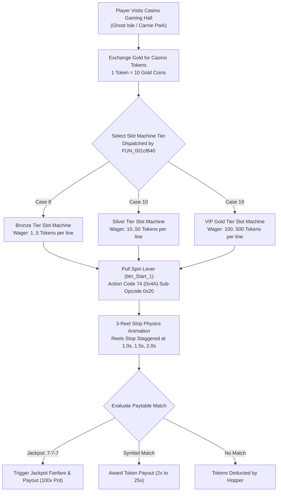

# Technical Specification 45: Casino Gaming Hall, Slot Machines, and Token Exchange

## 1. System Overview & Delphi Compilation Units

The Casino gaming hall and gambling amusement systems in Wonderland Online are managed by Delphi units:
- `CY_Casino.pas`: Core gambling state machines, random number generation, reel strip weighting, and payout multipliers.
- `BK_Casino.pas`: Graphical slot machine interface (`Slotmach_Exp_Form`), coin hopper counters, and spin lever animations.
- Token Cashier: Gold-to-Token exchange interface converting regular in-game gold into carnival gambling chips.

---

## 2. Graphical Interface: `Slotmach_Exp_Form`

Subroutine `FUN_001cf840` instantiates the slot machine console:
- **Dimensions:** Width `0x20d` (525 pixels), Height `0x199` (409 pixels).
- **Controls & Buttons:**
  - `btn_Start_1`: Spin button / mechanical lever trigger at $(X=119, Y=458)$, size $20 \times 56$ px.
  - `btn_Leave_1`: Cash out and exit dialog at $(X=234, Y=458)$, size $20 \times 56$ px.
  - `btn_close_s_1`: Top-right corner close button ($18 \times 18$ px) at $(X=359, Y=26)$.
  - 3 Rotary Reel Windows displaying rolling sprite strips.
  - Digital 7-Segment LED displays for: `CREDIT`, `BET`, and `WIN`.

---

## 3. Reel Symbols & Paytable Multipliers

Each reel strip contains 24 positions populated with seven distinct symbols:

| Symbol Name | Reel Strip Frequency | 3-Match Multiplier | Description |
|---|---|---|---|
| **Cherry** | 7 per reel | $2\times$ | Low tier; 1 cherry on reel 1 also pays $1\times$ |
| **Lemon** | 5 per reel | $4\times$ | Standard fruit payout |
| **Orange** | 4 per reel | $6\times$ | Standard fruit payout |
| **Watermelon** | 3 per reel | $10\times$ | High tier fruit |
| **Golden Bell** | 2 per reel | $15\times$ | Traditional brass bell |
| **BAR** | 2 per reel | $25\times$ | High-roller single BAR |
| **Lucky Seven (7)** | 1 per reel | $100\times$ + Jackpot | Progressive Grand Jackpot |

### 3.1 Payout Formula
For a given wager $W$ across $L$ paylines ($1 \le L \le 3$):
$$\text{Payout} = W \times M(\text{Symbol}) + \mathbb{I}(\text{7-7-7}) \times \text{ProgressiveJackpotPool}$$

---

## 4. Casino Token Exchange Cashier

Casino chips operate as an isolated economy currency:
- **Purchase Tariff:** 1 Casino Token = 10 Gold Coins.
- **Redemption Tariff:** 1 Casino Token = 9 Gold Coins ($10\%$ house commission rake).
- **Prize Redemption Counter:** Players exchange earned tokens for exclusive non-combat items:
  - Rare Plush Doll furniture items (`Item ID 48150`..`48155`)
  - Vehicle Upgrade Fuel Pellets
  - Alchemy Experience Books
  - Exclusive Fashion Outfits & Bunny Ears

---

## 5. Network Wire Protocol: Action Code 74 (`0x4A`)

Gambling spins and currency payouts communicate under **Action Code 74** (`0x4A`):

### 5.1 Sub-Opcode Matrix

| Sub-Opcode | Direction | Description | Payload Structure |
|---|---|---|---|
| `0x20` | Client $\to$ Server | Spin Slot Machine Request | `[AC: 0x4A] [Sub: 0x20] [MachineTier: 1] [WagerPerLine: 2] [LineCount: 1]` |
| `0x21` | Server $\to$ Client | Spin Result & Reel Stops | `[AC: 0x4A] [Sub: 0x21] [Reel1: 1] [Reel2: 1] [Reel3: 1] [PayoutTokens: 4] [RemainingBalance: 4]` |
| `0x22` | Client $\to$ Server | Buy Casino Tokens | `[AC: 0x4A] [Sub: 0x22] [TokenCount: 4]` |
| `0x23` | Client $\to$ Server | Cash Out Tokens | `[AC: 0x4A] [Sub: 0x23] [TokenCount: 4]` |
| `0x24` | Server $\to$ Client | Jackpot Broadcast Alert | `[AC: 0x4A] [Sub: 0x24] [WinnerName: 16] [JackpotAmount: 4]` |

---

## 6. Emulator Implementation Guidelines

1. **Server-Side RNG Enforcement:**
   - Reel outcomes and winning matches must strictly be computed server-side using cryptographically secure random numbers. The client merely renders the animation matching the server's pre-calculated stop indices.
2. **Jackpot Accumulator Safety:**
   - 1% of every wagered token is added to the progressive jackpot pool table `casino_jackpot`.
   - When a player lands three Lucky Sevens (`7-7-7`), the server broadcasts a golden announcement banner across the world server (`Action Code 24`) and resets the jackpot pool to base seed 10,000 tokens.
