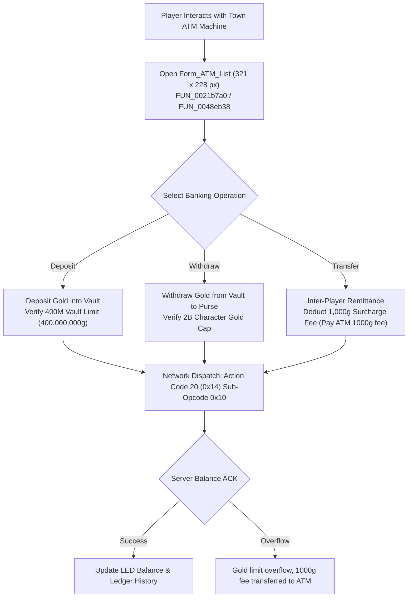

# Technical Specification 46: ATM Banking, Vault Deposits, and Currency Remittance

## 1. System Overview & Delphi Compilation Units

In-game commercial banking, secure gold storage, and inter-character currency remittance in Wonderland Online are managed by:
- `mWS_Operation.pas`: Interactive banking terminal interface, gold transfer verification, deposit cap checks, and ATM transaction fees.
- `BK_ATM.pas`: Graphical Automated Teller Machine (ATM) panel, numeric PIN entry, balance displays, and transaction ledgers.

---

## 2. Graphical Interface: `Form_ATM_List`

Subroutine `FUN_0021b7a0` (Line 227542 of `aLogin_decompiled.c`) constructs the ATM banking window:
- **Dimensions:** Width `0x141` (321 pixels), Height `0xe4` (228 pixels).
- **Centering Calculation:**
  $$X = \frac{\text{ViewportWidth} - 321}{2}, \quad Y = \frac{\text{ViewportHeight} - 228}{2}$$

### 2.1 Interface Controls & Visual Assets
- `TransferList`: Tabulated multi-row transaction ledger displaying recent remittances, deposits, and recipient character names.
- `btn_Check_1` (Array of 3 radio buttons): Operation selector tabs:
  1. Deposit Gold
  2. Withdraw Gold
  3. Transfer / Remittance to Other Player
- `bar_H4` & `Rail_H5`: Horizontal/vertical scrollbar controls for ledger navigation.
- `Btn_ArrowUp_1` & `Btn_ArrowDn_1`: Ledger line scrolling buttons ($17 \times 17$ px).
- `Btn_Close_s_1`: Exit button ($18 \times 18$ px) labeled `"[ESC]"` at $(X=178, Y=26)$.

---

## 3. Financial Rules, Vault Caps, and Tariffs

### 3.1 400M Deposit Cap (`FUN_0021ab99`)
The player's bank vault enforces a strict cumulative storage ceiling:
$$\text{VaultGold}_{\text{max}} = 400,000,000 \text{ Gold (400M)}$$
If a player attempts to deposit an amount that causes the vault balance to exceed 400,000,000 gold, the client aborts transmission and pops system toast:
`"ATM deposit limit 400M"` (Line 227408).

### 3.2 Remittance Surcharge Fee (Lines 230346 & 230358)
Every electronic remittance transferred to another player's bank account incurs a non-refundable flat handling fee:
$$\text{Fee} = 1,000 \text{ Gold}$$
1. When initiating transfer: Client outputs announcement `"Pay ATM 1000g fee"`.
2. When recipient claims remittance: Outputs announcement `"ATM 1000g fee received"`.

### 3.3 Gold Overflow Auto-Routing (Line 230366)
If a player receives a gold prize or trade payment when their personal purse is already at the maximum integer limit (2,000,000,000 gold), excess funds are automatically redirected to the ATM vault with notice:
`"Gold limit overflow, 1000g fee transferred to ATM"`.

---

## 4. Network Wire Protocol: Action Code 20 (`0x14`)

Banking operations operate under **Action Code 20** (`0x14`):

### 4.1 Sub-Opcode Matrix

| Sub-Opcode | Direction | Description | Payload Structure |
|---|---|---|---|
| `0x10` | Client $\to$ Server | Query Account Balance | `[AC: 0x14] [Sub: 0x10]` |
| `0x11` | Server $\to$ Client | Balance & Ledger Sync | `[AC: 0x14] [Sub: 0x11] [VaultGold: 4] [PurseGold: 4] [HistoryCount: 1] { [Date: 4] [Type: 1] [Amount: 4] [PeerName: 16] }*` |
| `0x12` | Client $\to$ Server | Deposit Gold | `[AC: 0x14] [Sub: 0x12] [Amount: 4]` |
| `0x13` | Client $\to$ Server | Withdraw Gold | `[AC: 0x14] [Sub: 0x13] [Amount: 4]` |
| `0x14` | Client $\to$ Server | Wire Transfer to Peer | `[AC: 0x14] [Sub: 0x14] [RecipientName: 16] [Amount: 4]` |
| `0x15` | Server $\to$ Client | Transaction Status | `[AC: 0x14] [Sub: 0x15] [Status: 1] [NewVaultGold: 4]` (`0 = Success`, `1 = Exceeds 400M`, `2 = Insufficient Funds`, `3 = Peer Not Found`) |

---

## 5. Emulator Implementation Guidelines

1. **Transactional Concurrency:**
   - Bank deposit, withdrawal, and wire transfers must be executed within database transactions with row-level locks (`SELECT FOR UPDATE`) on table `bank_accounts`.
2. **Account Security PIN:**
   - Players can register a 4-to-6 digit secondary bank PIN. The server must reject any withdrawal or wire transfer until the session submits a verified PIN handshake.
