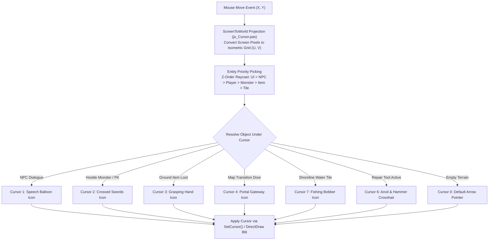

# Technical Specification 47: Interactive Cursor State Machine and Context Targeting

## 1. Subsystem Overview & Delphi Compilation Units

The user input targeting, contextual cursor morphing, and entity picking system in Wonderland Online is implemented in compilation unit `jo_Cursor.pas`. The module abstracts between native Win32 hardware cursors (`user32.dll`) and DirectDraw software cursor rendering, dynamically altering cursor icons based on hovered game objects.

---

## 2. Win32 vs DirectDraw Software Cursor Pipelines

Subroutines `FUN_000412d0` and `FUN_00041674` manage the dual cursor rendering modes:

### 2.1 Hardware Cursor Mode (`DAT_004ca780 == 0`)
- Interacts directly with native Windows display drivers via `user32.dll`:
  - `GetCursorPos((LPPOINT)&DAT_004ca770)`
  - `SetCursor(pHVar6)`
- Zero latency; updates asynchronously with GPU display scanout.

### 2.2 DirectDraw Software Blit Mode (`DAT_004ca780 != 0`)
- Hides OS cursor via `ShowCursor(FALSE)` and blits customized alpha-blended animated sprites onto the DirectDraw backbuffer prior to surface flip.
- Used when screen scaling or special overlay rendering is engaged.

---

## 3. Contextual Cursor State Dispatch Table

Subroutine `FUN_0005f314(*(undefined4 *)PTR_DAT_004c9890, CursorID)` maps contextual interaction codes into visual assets:

| Cursor ID | Visual Asset Tag | Interaction Context | Action on Left-Click |
|---|---|---|---|
| `0x00` | `Cursor_Default` | Open terrain or standard interface background | Move character to target tile |
| `0x01` | `Cursor_Talk` | Hovering friendly NPC / Shopkeeper / Quest giver | Open dialogue tree (Action Code 39) |
| `0x02` | `Cursor_Attack` | Hovering attackable monster or PK opponent | Engage combat encounter (Action Code 11) |
| `0x03` | `Cursor_Pickup` | Hovering dropped ground item or coin pouch | Pick up item into bag (Action Code 24) |
| `0x04` | `Cursor_Door` | Hovering scene transition portal / cave entrance | Warp to target scene (Action Code 13) |
| `0x05` | `Cursor_Inspect` | Inspecting equipment or player character profile | Open character information card |
| `0x06` | `Cursor_Repair` | Durability Repair Hammer tool actively selected | Target equipment for repair (Action Code 23) |
| `0x07` | `Cursor_Fish` | Hovering shoreline water tile with rod equipped | Cast fishing bobber (Action Code 23) |
| `0x08` | `Cursor_Trade` | Hovering friendly player with trade mode active | Send trade invitation (Action Code 21) |
| `0x09` | `Cursor_Gather` | Hovering tree, ore vein, or clay mound | Begin resource gathering cycle |

---

## 4. Entity Raycasting & Depth Priority Hierarchy

When multiple entities overlap at the cursor coordinates $(P_x, P_y)$, subroutine `FUN_00042e08` evaluates picking precedence according to a strict priority hierarchy:

$$\text{Priority: } \text{UI Controls} > \text{Friendly NPCs} > \text{Party Members} > \text{Monsters} > \text{Ground Items} > \text{Scene Portals} > \text{Terrain Tiles}$$

### 4.1 Hitbox AABB & Diamond Footprint
- **Character Entities:** Bounded by an upright ellipse:
  $$\frac{(x - X_{\text{actor}})^2}{16^2} + \frac{(y - Y_{\text{actor}} + 30)^2}{35^2} \le 1$$
- **Ground Items:** Bounded by a $24 \times 24$ pixel box centered on item anchor.
- **Portals:** Polygons defined in `SceneData.dat` trigger registers.

---

## 5. Input Dispatch & Network Emission

Mouse clicks on resolved entities emit corresponding client packets:
- **Left-Click on Ground:** Calls pathfinder `FUN_00432818` and dispatches Action Code 6 movement step.
- **Left-Click on NPC:** Dispatches Action Code 39 dialogue query.
- **Left-Click on Monster:** Dispatches Action Code 11 encounter challenge.
- **Right-Click on Player:** Opens contextual radial popup menu (Party Invite, Trade, Whisper, Add Friend, Duel).
