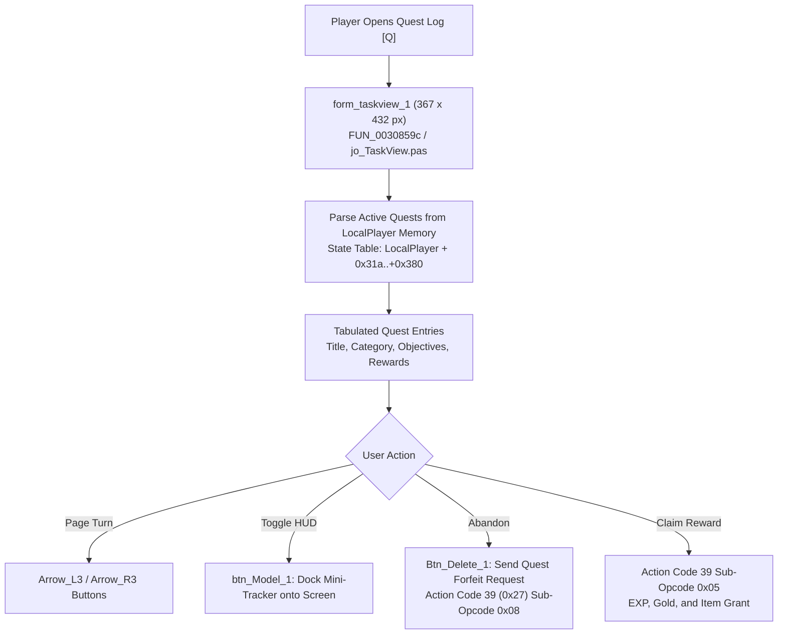

# Technical Specification 48: Quest Journal, Task Tracker, and Multi-Objective Engine

## 1. Subsystem Architecture & Delphi Package Units

In Wonderland Online, quest progression tracking, multi-objective completion monitoring, and quest log rendering are managed by:
- `jo_TaskView.pas`: Core task tracker state machine, objective counter evaluator, and quest journal pagination.
- `BK_TaskView.pas`: Graphical journal interface (`form_taskview_1`) and desktop HUD mini-tracker overlay.
- `AC_Talk.pas`: Dialogue tree branching and quest state persistence.



---

## 2. Graphical Interface: `form_taskview_1`

Subroutine `FUN_0030859c` (Line 299958 of `aLogin_decompiled.c`) constructs the quest journal:
- **Dimensions:** Width `0x16f` (367 pixels), Height `0x1b0` (432 pixels).
- **Positioning:** Configured at default screen coordinates $(X=80, Y=60)$.

### 2.1 Interface Controls & Visual Assets
- `Arrow_L3` & `Arrow_R3`: Animated page turning buttons ($21 \times 21$ px) at $Y = 298$.
- `bar_H4` & `rail_H4`: Dual vertical scrollbar rails for quest list and detail descriptions.
- `Btn_Close_s_1`: Top-right corner close button ($18 \times 18$ px).
- `Btn_Close_1`: Bottom cancel button ($20 \times 56$ px).
- `Btn_Delete_1`: Abandon quest button ($20 \times 56$ px) at $(X=290, Y=332)$.
- `btn_Model_1`: HUD pinned mini-tracker button ($20 \times 56$ px) at $(X=330, Y=332)$.
- `icon_start_1`: Gold star bullet point indicating active quest items (`menu\skins\default\icon_start_1`).

---

## 3. Quest Data Structures & Objective Types

Each quest is cataloged in the client's static database `Talk.dat` and tracked dynamically:

### 3.1 Quest Status Enum
```c
typedef enum {
    QUEST_INACTIVE   = 0, // Not accepted yet
    QUEST_ACTIVE     = 1, // Currently in progress
    QUEST_COMPLETE   = 2, // Objectives fulfilled, ready to claim
    QUEST_FINISHED   = 3, // Reward claimed and archived
    QUEST_FAILED     = 4  // Time expired or failed precondition
} QuestState;
```

### 3.2 Objective Types Evaluated by `jo_TaskView.pas`
1. **Monster Cull Objective:**
   - Tracks monster kill counts: $\text{CurrentKill} / \text{RequiredKill}$.
   - Increments automatically when combat round ends (Action Code 11).
2. **Item Gathering Objective:**
   - Checks player bag for required quest items: $\text{InventoryCount} / \text{RequiredCount}$.
3. **NPC Visit / Escort Objective:**
   - Requires reaching designated $(X, Y)$ coordinate boundaries on a specific Map ID.
4. **Dialogue Choice Objective:**
   - Verifies player selected correct branch options in `Form_Talk_1/2/3`.

---

## 4. Quest Abandonment & HUD Docking Engine

### 4.1 Abandonment Logic (`Btn_Delete_1`)
- When clicked, client prompts confirmation modal.
- Storyline main quests (e.g. Robinson Crusoe, Holy Village Main Arc) are tagged non-abandonable (`Quest[Flags] & 0x01`).
- Forfeiting a daily or side quest purges the associated quest items from the bag and resets progression registers.

### 4.2 Desktop HUD Mini-Tracker (`btn_Model_1`)
- Toggles floating semi-transparent HUD overlay on the upper-right corner of the gameplay screen ($X=620, Y=120$).
- Displays up to 3 pinned active quests with live kill/gather counts.

---

## 5. Network Wire Protocol: Action Code 39 (`0x27`)

Quest updates and dialogue interaction communicate on **Action Code 39** (`0x27`):

### 5.1 Sub-Opcode Matrix

| Sub-Opcode | Direction | Description | Payload Structure |
|---|---|---|---|
| `0x01` | Client $\to$ Server | Request Quest Journal Sync | `[AC: 0x27] [Sub: 0x01]` |
| `0x02` | Server $\to$ Client | Full Quest State Manifest | `[AC: 0x27] [Sub: 0x02] [QuestCount: 2] { [QuestID: 2] [State: 1] [Progress1: 2] [Progress2: 2] }*` |
| `0x03` | Server $\to$ Client | Single Quest Progress Delta | `[AC: 0x27] [Sub: 0x03] [QuestID: 2] [ObjectiveIdx: 1] [NewProgress: 2]` |
| `0x05` | Client $\to$ Server | Claim Quest Reward | `[AC: 0x27] [Sub: 0x05] [QuestID: 2] [NpcID: 2]` |
| `0x06` | Server $\to$ Client | Reward Delivery Notice | `[AC: 0x27] [Sub: 0x06] [QuestID: 2] [GainedEXP: 4] [GainedGold: 4] [ItemID: 2] [ItemCount: 2]` |
| `0x08` | Client $\to$ Server | Abandon Quest | `[AC: 0x27] [Sub: 0x08] [QuestID: 2]` |

---

## 6. Emulator Implementation Guidelines

1. **Prerequisite & Level Checks:**
   - Server must enforce minimum character level, prerequisite completed quest IDs, and companion pet presence before allowing a quest to transition into `QUEST_ACTIVE`.
2. **Reward Delivery Safety:**
   - Verify inventory bag has sufficient empty slots before delivering quest item rewards. If bag is full, withhold reward and prompt the player to free bag space.
