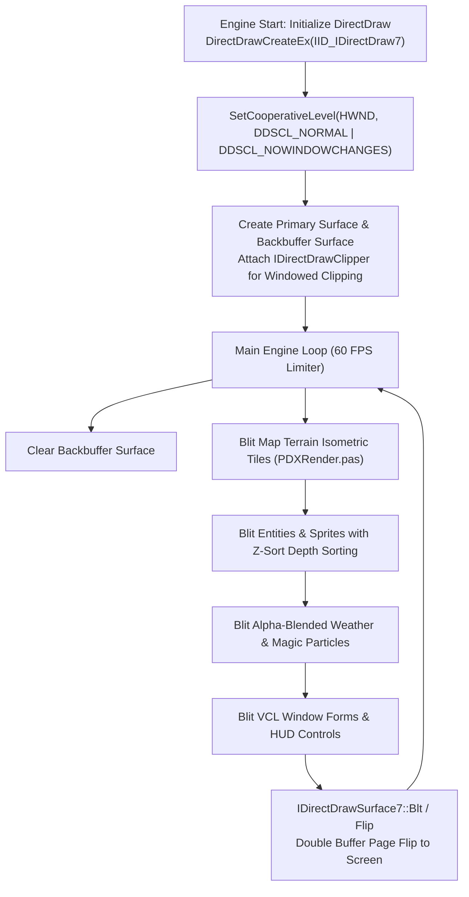

# Technical Specification 49: DirectDraw Multimedia Rendering Loop and Surface Pipelines

## 1. System Overview & Delphi Compilation Units

The low-level 2D graphics hardware acceleration, video surface management, and audio playback engines in Wonderland Online are driven by Delphi units:
- `rDXETable.pas`: Fast color lookup tables, 16-bit RGB 565/555 color conversion, and software alpha blending.
- `PDXRender.pas`: Main display pipeline, double-buffered page flipping, and hardware blit orchestration.
- `DXDraws.pas`: Object-oriented VCL wrappers for Microsoft DirectX DirectDraw 7 and DirectSound.



---

## 2. DirectDraw 7 COM Interface Bindings

Subroutines starting at line 79297 of `aLogin_decompiled.c` dynamically bind export pointers from `DDraw.dll`:
- `DirectDrawEnumerateA`: Scans active display adapters.
- `DirectDrawCreate` / `DirectDrawCreateEx`: Instantiates the primary `IDirectDraw7` interface.
- COM Interfaces Created:
  - `IDirectDraw7`: Master graphics driver context.
  - `IDirectDrawSurface7`: Hardware video memory surfaces (Primary and Backbuffer).
  - `IDirectDrawPalette`: 256-color palette controller for 8-bit indexed assets.
  - `IDirectDrawClipper`: Windowed mode boundary clipping preventing drawing outside client rect.

---

## 3. Surface Architecture & 16-Bit Color Pipelines

The game engine operates natively in **16-bit High Color** mode:

### 3.1 Pixel Format Detection (RGB 565 vs RGB 555)
During initialization, the client inspects the surface pixel format flags:
- **RGB 565 (Default):** Red 5 bits, Green 6 bits, Blue 5 bits.
  $$\text{Pixel16} = ((R \gg 3) \ll 11) \mid ((G \gg 2) \ll 5) \mid (B \gg 3)$$
- **RGB 555 (Fallback):** Red 5 bits, Green 5 bits, Blue 5 bits.
  $$\text{Pixel16} = ((R \gg 3) \ll 10) \mid ((G \gg 3) \ll 5) \mid (B \gg 3)$$

### 3.2 Fast Alpha Blending Lookup Tables (`rDXETable.pas`)
To achieve high-performance 60 FPS particle blending on legacy hardware without GPU shaders:
- Pre-computes half-intensity lookup tables for 50% transparency:
  $$\text{Blend50}(C_1, C_2) = ((C_1 \land 0\text{xF7DE}) \gg 1) + ((C_2 \land 0\text{xF7DE}) \gg 1)$$
- Used for player shadows, ghost mode transparency, water reflections, and spell illumination glows.

---

## 4. Double Buffering & Framerate Limiter

### 4.1 Page Flipping Workflow
1. All rendering operations occur strictly on the offline **Backbuffer Surface** (`DDSCAPS_BACKBUFFER | DDSCAPS_VIDEOMEMORY`).
2. When the scene composition completes, the engine copies the backbuffer onto the primary display surface via `IDirectDrawSurface7::Blt()`:
   ```c
   pPrimarySurface->Blt(&destRect, pBackBuffer, &srcRect, DDBLT_WAIT, NULL);
   ```

### 4.2 60 FPS VSync Arbitration
To prevent screen tearing and excessive CPU utilization:
- Checks hardware vertical blank scanout via `WaitForVerticalBlank(DDWAITVB_BLOCKBEGIN, NULL)`.
- If hardware vsync is unavailable, uses multimedia timer `timeGetTime()` with a target frame duration of $16.66$ ms ($60\text{ Hz}$).

---

## 5. DirectSound Audio Subsystem (`DSound.dll`)

Sound effects and background music are coordinated by subroutines starting at line 87658:
- **COM Interface Bindings:** Dynamically links `DirectSoundCreate` to instantiate `IDirectSound` and `IDirectSoundBuffer`.
- **Primary Sound Buffer:** Initialized at CD quality: 44,100 Hz, 16-bit Stereo, PCM format.
- **Secondary Sound Buffers:** Audio pool caching up to 32 concurrent waveform sounds (`sound\*.wav`) for combat hits, footsteps, and UI clicks with hardware 2D panning.
