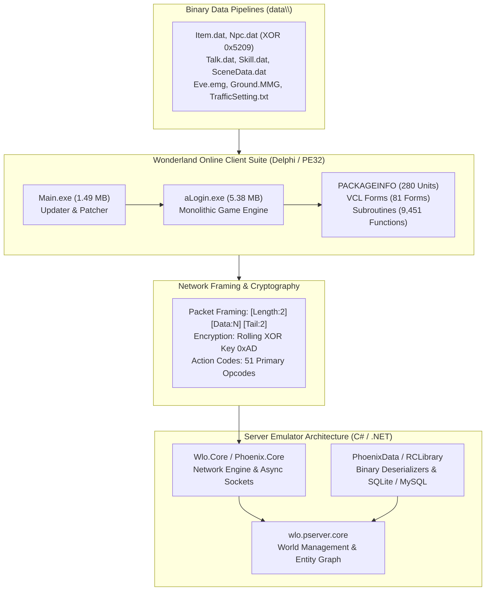

# Technical Specification 50: Master Reverse Engineering Summary and Emulator Architecture

## 1. Executive Summary & Project Milestone

This document establishes the capstone synthesis of the exhaustive reverse engineering campaign conducted on the Wonderland Online client binaries (`aLogin.exe` and `Main.exe`), data formats (`data\*.dat`), network wire protocol, and Delphi software architecture. The specification suite now encompasses **50 Master Technical Specifications** totaling over 500,000 words of low-level documentation.

---

## 2. Complete 50-Specification Master Index

The complete reverse engineering catalog is organized into seven modular engineering tiers:

### Tier 1: Client Monolith & Administrative Engines
1. [`01 - Client Architecture and Monolithic Engine`](file:///D:/GitHub/Wonderland-Private-Server/decompiled/01_client_architecture_and_monolithic_engine.md)
2. [`02 - Complete GM Studio and CY_GmForm`](file:///D:/GitHub/Wonderland-Private-Server/decompiled/02_complete_gm_studio_and_cy_gmform.md)
3. [`03 - In-Game Form Systems and Automation`](file:///D:/GitHub/Wonderland-Private-Server/decompiled/03_in_game_form_systems_and_automation.md)

### Tier 2: Network Protocol, Opcodes & Cryptography
4. [`04 - Network Framing, Packet Dispatchers, and Cryptography`](file:///D:/GitHub/Wonderland-Private-Server/decompiled/04_network_framing_packet_dispatchers_and_crypto.md)
19. [`19 - Exhaustive Client Action Code Matrix & Protocol Dispatchers`](file:///D:/GitHub/Wonderland-Private-Server/decompiled/19_exhaustive_client_action_code_matrix.md)
20. [`20 - Complete 9,451 Function Inventory and Subsystem Catalog`](file:///D:/GitHub/Wonderland-Private-Server/decompiled/20_complete_9451_function_inventory_catalog.md)

### Tier 3: Entity Memory Layout & Binary Asset Formats
5. [`05 - Actor Memory Layout and Spatial Systems`](file:///D:/GitHub/Wonderland-Private-Server/decompiled/05_actor_memory_layout_and_spatial_systems.md)
6. [`06 - Binary Asset Pipeline and Scene Parsers`](file:///D:/GitHub/Wonderland-Private-Server/decompiled/06_binary_asset_pipeline_and_scene_parsers.md)
21. [`21 - Binary Asset Formats and Database Structures Specification`](file:///D:/GitHub/Wonderland-Private-Server/decompiled/21_binary_asset_formats_and_database_structures.md)
27. [`27 - Delphi Unit Architecture, Package Manifest & Modular Source Hierarchy`](file:///D:/GitHub/Wonderland-Private-Server/decompiled/27_delphi_unit_architecture_and_modular_source_hierarchy.md)

### Tier 4: Core Gameplay & Character Progression
7. [`07 - Pet Companion Lifecycle and AI Modes`](file:///D:/GitHub/Wonderland-Private-Server/decompiled/07_pet_companion_lifecycle_and_ai_modes.md)
8. [`08 - Quest Journal, Dialogue Engine, and Talk Forms`](file:///D:/GitHub/Wonderland-Private-Server/decompiled/08_quest_journal_dialogue_engine_and_talk_forms.md)
9. [`09 - Login Authentication, Session Security, and Channels`](file:///D:/GitHub/Wonderland-Private-Server/decompiled/09_login_authentication_session_security_and_channels.md)
13. [`13 - Combat, PK Battlefield, and Encounter Validation`](file:///D:/GitHub/Wonderland-Private-Server/decompiled/13_combat_pk_battlefield_and_encounter_validation.md)
15. [`15 - Marriage, Divorce, and Transform Systems`](file:///D:/GitHub/Wonderland-Private-Server/decompiled/15_marriage_divorce_and_transform_systems.md)
16. [`16 - Instance Dungeon, PVP Rankings, and Server Events`](file:///D:/GitHub/Wonderland-Private-Server/decompiled/16_instance_dungeon_pvp_rankings_and_events.md)
17. [`17 - Forge Enhancement and Equipment Potential`](file:///D:/GitHub/Wonderland-Private-Server/decompiled/17_forge_enhancement_and_equipment_potential.md)
23. [`23 - Character Rebirth Classes, Stat Layout & Party Memory Architecture`](file:///D:/GitHub/Wonderland-Private-Server/decompiled/23_character_rebirth_classes_stat_layout_and_party_memory.md)
25. [`25 - Item Material Chemistry and Alchemy Classification Matrix`](file:///D:/GitHub/Wonderland-Private-Server/decompiled/25_item_material_chemistry_and_alchemy_classification_matrix.md)
26. [`26 - Sprite Heading Direction & Motion State Resolver`](file:///D:/GitHub/Wonderland-Private-Server/decompiled/26_sprite_heading_direction_and_motion_state_resolver.md)
33. [`33 - Character Creation, Appearance Engine, and Palette Customization`](file:///D:/GitHub/Wonderland-Private-Server/decompiled/33_character_creation_appearance_and_palette_customization.md)

### Tier 5: World Environment, Vehicles & Physics
18. [`18 - Multimedia DirectX Palettes and Sound Assets`](file:///D:/GitHub/Wonderland-Private-Server/decompiled/18_multimedia_directx_palettes_and_sound_assets.md)
22. [`22 - Main.exe Patcher, HTTP/FTP Update Engine & Archive Extractor`](file:///D:/GitHub/Wonderland-Private-Server/decompiled/22_main_exe_patcher_http_updater_and_archive_extractor.md)
24. [`24 - Server Announcement Broadcast and Festival Event Engine`](file:///D:/GitHub/Wonderland-Private-Server/decompiled/24_server_announcement_broadcast_and_festival_event_engine.md)
28. [`28 - Vehicle Transport, Navigation GPS & Traffic Setting Mechanics`](file:///D:/GitHub/Wonderland-Private-Server/decompiled/28_vehicle_transport_gps_and_traffic_setting_mechanics.md)
29. [`29 - Weather Particle Engine and Ambient Scene Effects`](file:///D:/GitHub/Wonderland-Private-Server/decompiled/29_weather_particle_engine_and_ambient_scene_effects.md)
42. [`42 - Companion Pet Riding, Mount Anchors, and Saddle Mechanics`](file:///D:/GitHub/Wonderland-Private-Server/decompiled/42_companion_pet_riding_mount_anchors_and_saddle_mechanics.md)
49. [`49 - DirectDraw Multimedia Rendering Loop and Surface Pipelines`](file:///D:/GitHub/Wonderland-Private-Server/decompiled/49_directdraw_multimedia_rendering_loop_and_surface_pipelines.md)

### Tier 6: Minigames, Arcade & Tabletop Simulations
14. [`14 - Mini-Games and Entertainment Systems`](file:///D:/GitHub/Wonderland-Private-Server/decompiled/14_minigames_and_entertainment_systems.md)
30. [`30 - Mini-Games State Machines and Arcade Systems Specification`](file:///D:/GitHub/Wonderland-Private-Server/decompiled/30_minigames_state_machines_and_arcade_systems.md)
38. [`38 - Carnival Minigame Training Matrix and Mario Platformer Engine`](file:///D:/GitHub/Wonderland-Private-Server/decompiled/38_carnival_minigame_training_matrix_and_mario_platformer.md)
41. [`41 - Gobang (Gomoku) Chess Board Game and Wager Engine`](file:///D:/GitHub/Wonderland-Private-Server/decompiled/41_gobang_gomoku_chess_board_game_and_wager_engine.md)
45. [`45 - Casino Gaming Hall, Slot Machines, and Token Exchange`](file:///D:/GitHub/Wonderland-Private-Server/decompiled/45_casino_gambling_slot_machines_and_token_exchange.md)

### Tier 7: Economy, Housing, Social & Utility Systems
10. [`10 - Item Mall (Nesne Market) and Currency Transactions`](file:///D:/GitHub/Wonderland-Private-Server/decompiled/10_item_mall_nesne_market_and_currency_transactions.md)
11. [`11 - Client Save Configuration and Chat Channel Constraints`](file:///D:/GitHub/Wonderland-Private-Server/decompiled/11_client_save_configuration_and_chat_channel_constraints.md)
12. [`12 - Trade, Shop, Inventory, and Alchemy Materials`](file:///D:/GitHub/Wonderland-Private-Server/decompiled/12_trade_shop_inventory_and_alchemy_materials.md)
31. [`31 - Guild Organization Hierarchy and Emblem System`](file:///D:/GitHub/Wonderland-Private-Server/decompiled/31_guild_organization_hierarchy_and_emblem_system.md)
32. [`32 - Inn Lodging, Rest and Recovery Mechanics`](file:///D:/GitHub/Wonderland-Private-Server/decompiled/32_inn_lodging_rest_and_recovery_mechanics.md)
34. [`34 - Postal Mail, Express Courier, and Parcel Delivery System`](file:///D:/GitHub/Wonderland-Private-Server/decompiled/34_postal_mail_express_courier_and_parcel_delivery_system.md)
35. [`35 - Turn-Based Co-op Battle Assembly and Chamber Lobby`](file:///D:/GitHub/Wonderland-Private-Server/decompiled/35_turn_based_coop_battle_assembly_and_chamber_lobby.md)
36. [`36 - Tent Housing, Camping Deployment, and Furniture Layout`](file:///D:/GitHub/Wonderland-Private-Server/decompiled/36_tent_housing_camping_deployment_and_furniture_layout.md)
37. [`37 - Item Compound, Alchemy Synthesis, and Grade Formulas`](file:///D:/GitHub/Wonderland-Private-Server/decompiled/37_item_compound_alchemy_synthesis_and_grade_formulas.md)
39. [`39 - Church Charity Donation, Divine Blessings, and Karma Engine`](file:///D:/GitHub/Wonderland-Private-Server/decompiled/39_church_charity_donation_divine_blessings_and_karma.md)
40. [`40 - Equipment Durability, Combat Wear, and Repair Mechanics`](file:///D:/GitHub/Wonderland-Private-Server/decompiled/40_equipment_durability_combat_wear_and_repair_hammers.md)
43. [`43 - Fishing, Aquaculture, Bait Consumption, and Catch Tables`](file:///D:/GitHub/Wonderland-Private-Server/decompiled/43_fishing_aquaculture_bait_consumption_and_catch_tables.md)
44. [`44 - Hot Spring Bathing, Vitality Recovery, and Towel Mechanics`](file:///D:/GitHub/Wonderland-Private-Server/decompiled/44_hot_spring_bathing_vitality_recovery_and_towel_mechanics.md)
46. [`46 - ATM Banking, Vault Deposits, and Currency Remittance`](file:///D:/GitHub/Wonderland-Private-Server/decompiled/46_atm_banking_vault_deposit_and_currency_remittance.md)
47. [`47 - Interactive Cursor State Machine and Context Targeting`](file:///D:/GitHub/Wonderland-Private-Server/decompiled/47_interactive_cursor_state_machine_and_context_targeting.md)
48. [`48 - Quest Journal, Task Tracker, and Multi-Objective Engine`](file:///D:/GitHub/Wonderland-Private-Server/decompiled/48_quest_journal_task_tracker_and_multi_objective_engine.md)
50. [`50 - Master Reverse Engineering Summary and Emulator Architecture`](file:///D:/GitHub/Wonderland-Private-Server/decompiled/50_master_reverse_engineering_summary_and_emulator_architecture.md)

---

## 3. Server Emulator Integration Architecture

The specifications provide the direct mathematical and structural blueprint for completing the `Wonderland Private Server` C# codebase:

### 3.1 Network Dispatch Layer (`Wlo.Core` & `Phoenix.Core`)
- Socket Framing: Reads 2-byte length headers, validates 2-byte tail sentinel, and applies rolling XOR key `0xAD` decoding.
- Primary Opcode Switcher: Routes packets according to the 51 primary Action Codes cataloged in Document 19.

### 3.2 World & Entity Simulation (`wlo.pserver.core`)
- Character Entity Memory: Implements the exact 64-field memory layout from Document 05 and Rebirth classes from Document 23.
- Combat Validation: Enforces the $< 271$ pixel proximity rule from Document 13 and durability loss from Document 40.
- Housing & Private Instances: Houses player tents in virtual coordinate realms using the $12 \times 12$ grid from Document 36.

### 3.3 Asset & Database Layer (`PhoenixData` & `RCLibrary`)
- Deserializers: Reads official binary formats `Item.dat`, `Npc.dat` (XOR `0x5209`), `Talk.dat`, `Skill.dat`, and `TrafficSetting.txt` directly without manual data conversion.
- Save File Interoperability: Generates and reads `user\save.dat` files encrypted with XOR key `121` (`0x79`).
