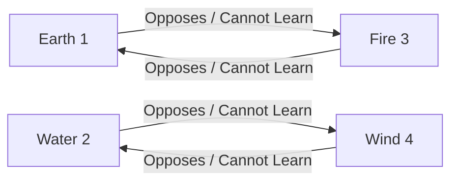

# 51 - Skill Tree, Elemental Affinity, and Learning Mechanics Specification

## 1. Architectural Overview & Source Mapping

The character and companion skill progression systems in Wonderland Online are governed by Delphi unit `se_SkillTree.pas` and associated combat skill tables. The client visualizes progression via `Form_SkillTree` and `form_npcSkillTree`, dynamically filtering available abilities based on character elemental alignment, prerequisite mastery trees, and unallocated skill point pools.

### Subroutine Inventory & Source Locations

| Virtual Address | Subroutine Symbol | File / Unit | Purpose |
| :--- | :--- | :--- | :--- |
| `0x00257018` | `FUN_00257018` | `se_SkillTree.pas` | Elemental opposition validation and restriction alerts |
| `0x002572b8` | `FUN_002572b8` | `se_SkillTree.pas` | Skill node button state initialization and tooltip assembly |
| `0x00258198` | `FUN_00258198` | `se_SkillTree.pas` | Rebirth skill unlock state verification (`+0x235c == 0x29cd`) |
| `0x002582d4` | `FUN_002582d4` | `se_SkillTree.pas` | Skill point upgrade button click event handler and cost calculator |
| `0x00258c2c` | `FUN_00258c2c` | `se_SkillTree.pas` | Skill tree UI refresh, unallocated point synchronization |
| `0x00258cf4` | `FUN_00258cf4` | `se_SkillTree.pas` | Skill node array reset and graphic texture binder (`icon_sk`) |
| `0x0025933c` | `FUN_0025933c` | `se_SkillTree.pas` | `form_npcSkillTree` dialog constructor ($272 \times 380$ px) |
| `0x00259674` | `FUN_00259674` | `se_SkillTree.pas` | Skill point allocation commit handler and network packet assembly |

---

## 2. Form Geometry & UI Layout

The skill tree interface is split between character progression (`Form_SkillTree`) and companion / NPC training (`form_npcSkillTree`).

```
+-------------------------------------------------------------+
| [icon] Skill Tree Progression                [Btn_Close_s_1]|
+-------------------------------------------------------------+
|  Available Skill Points: [LocalPlayer + 0x1fa4]             |
|                                                             |
|  [Tab: Earth]  [Tab: Water]  [Tab: Fire]  [Tab: Wind]       |
|  +-------------------------------------------------------+  |
|  |  [Skill Node 1] ---> [Skill Node 2] ---> [Skill Node 3]|  |
|  |       |                    |                          |  |
|  |       v                    v                          |  |
|  |  [Branch A]           [Branch B]       [Ultimate]     |  |
|  +-------------------------------------------------------+  |
|  Node Info: [Skill Name] (LV: 0 / 10)                        |
|  Prerequisites: [Req Skill 1] / [Req Skill 2]                |
|  Cost: [1 Pt (Affinity) / 2 Pts (Cross-Element)]             |
|                                                             |
|  [btn_ok_1 (Confirm)]   [btn_cancel]        [btn_Readme]    |
+-------------------------------------------------------------+
```

### Form Specifications

- **Form Name:** `form_npcSkillTree` / `Form_SkillTree`
- **Dimensions:** Width = `0x110` (272 pixels), Height = `0x17c` (380 pixels)
- **Top / Left Offsets:** Positioned dynamically relative to screen center.
- **Controls & Resources:**
  - `icon_levelUp`: Progression icon indicator.
  - `Btn_Close_s_1`: Small close button at $(X=249, Y=17)$.
  - `btn_ok_1`: Commit allocation button at $(X=105, Y=25, W=70, H=226)$.
  - `btn_cancel`: Discard changes button at $(X=205, Y=25, W=70, H=226)$.
  - `btn_Readme`: Skill documentation help button at $(X=277, Y=25, W=70, H=74)$.
  - `btn_blank`: 4-column node slot buttons with stride $X = (i - 1) \times 0x2f + 0x7f$.

---

## 3. Elemental Affinity & Opposition Rules (`FUN_00257018`)

Every character in Wonderland Online belongs to one of four elemental affinities stored at `*(byte *)(LocalPlayer + 0x1f82)`:
- `1`: Earth (地)
- `2`: Water (水)
- `3`: Fire (火)
- `4`: Wind (風)

The game enforces strict elemental opposition cycles. A character is strictly forbidden from learning skills belonging to their opposing element:



### Decompiled Opposition Logic (`FUN_00257018`)

```c
cVar1 = *(char *)(*(int *)PTR_DAT_004c9918 + 0x1f82); // Character Element (1..4)
if (cVar1 == '\x01') {
    iVar4 = 3; // Earth opposes Fire
} else if (cVar1 == '\x02') {
    iVar4 = 4; // Water opposes Wind
} else if (cVar1 == '\x03') {
    iVar4 = 1; // Fire opposes Earth
} else {
    iVar4 = param_1;
    if (cVar1 == '\x04') {
        iVar4 = 2; // Wind opposes Water
    }
}
if (iVar4 == param_2 + 1) { // param_2: 0=Earth, 1=Water, 2=Fire, 3=Wind
    if (param_2 == 0) {
        ShowAlert("Can't learn Earth skill", 2000);
    } else if (param_2 == 1) {
        ShowAlert("Can't learn Water skill", 2000);
    } else if (param_2 == 2) {
        ShowAlert("Can't learn Fire skill", 2000);
    } else if (param_2 == 3) {
        ShowAlert("Can't learn Wind skill", 2000);
    }
    return; // Block learning
}
```

---

## 4. Skill Point Economy & Cost Calculus (`FUN_002582d4`)

Skills require investment of unallocated skill points (`*(ushort *)(LocalPlayer + 0x1fa4)`). The cost calculus differentiates between **Primary Affinity Skills** and **Cross-Element Skills**:

### Skill Node Data Structure (Stride = `0x15c` bytes)

| Memory Offset | Data Type | Field Name | Description |
| :--- | :--- | :--- | :--- |
| `+0x4c` | `uint32` | `TextureHandle` | DirectDraw surface handle (`icon_sk` + ID) |
| `+0x70` | `void*` | `OnClickCallback` | Subroutine pointer (`FUN_002582d4`) |
| `+0x74` | `void*` | `OwnerForm` | Parent form pointer |
| `+0xb0` | `int32` | `NodeIndex` | Linear skill node index |
| `+0xd0` | `uint8` | `StateFlags` | Active, hover, pressed, disabled states |
| `+0xf8` | `uint8` | `IsAvailable` | $1 =$ node selectable, $0 =$ locked / learned |
| `+0x110` | `void***` | `SkillTreeGrid` | 2D matrix of tree nodes ($5 \times 16$) |
| `+0x118` | `int32` | `TempAllocPoints` | Skill points allocated during active session |
| `+0x138` | `uint8` | `BaseLevel` | Current base skill level (persisted from server) |
| `+0x139` | `uint8` | `AddedLevel` | Uncommitted added level increments |
| `+0x13a` | `uint8` | `TotalInvested` | Total skill points invested in this skill node |
| `+0x13c` | `uint16` | `SkillID` | 16-bit skill identifier (`Skill.dat` reference) |
| `+0x140` | `void*` | `PrereqSkill1` | Pointer to first prerequisite node (or NULL) |
| `+0x144` | `void*` | `PrereqSkill2` | Pointer to second prerequisite node (or NULL) |
| `+0x15c` | `char*` | `TooltipText` | Dynamic tooltip string buffer |

### Cost Calculation Formulas

1. **Maximum Level Cap:**
   $$\text{Total Level} = \text{BaseLevel} + \text{AddedLevel} \le 10$$
   If $\text{Total Level} == 10$, the client rejects further clicks with `" reached max LV"`.

2. **Affinity Match (Same Element):**
   - **Initial Unlock (LV 0 $\to$ 1):**
     $$\text{Cost} = \text{BaseReqPoints}$$
   - **Subsequent Level-Ups (LV $N \to N+1$):**
     $$\text{Cost} = 1\text{ Skill Point per Level}$$

3. **Cross-Element Match (Different Element, Non-Opposed):**
   - **Initial Unlock (LV 0 $\to$ 1):**
     $$\text{Cost} = \text{BaseReqPoints} \times 2 \quad \text{(Doubled initial penalty)}$$
   - **Subsequent Level-Ups (LV $N \to N+1$):**
     $$\text{Cost} = 1\text{ Skill Point per Level}$$

### Prerequisite Chain Validation

Before permitting an upgrade, the engine inspects the prerequisite pointers:
```c
iVar1 = CurrentNode;
iVar2 = *(int *)(iVar1 + 0x140); // Prereq 1
if ((iVar2 != 0) && (*(int *)(iVar1 + 0x144) != 0)) {
    // Both prerequisites exist: check if both are unlearned (LV == 0)
    bool p1_unlearned = ((*(byte *)(Prereq1 + 0x138) + *(byte *)(Prereq1 + 0x139)) == 0);
    bool p2_unlearned = ((*(byte *)(Prereq2 + 0x138) + *(byte *)(Prereq2 + 0x139)) == 0);
    if (p1_unlearned && p2_unlearned) {
        ShowAlert("Prerequisite skills required to learn", 2000);
        return;
    }
}
```

---

## 5. Wire Protocol & Packet Framing (`FUN_00259674`)

When the player clicks `btn_ok_1`, uncommitted points are assembled into an Action Code 29 / 45 packet and transmitted across the network stream.

### Client-to-Server Skill Allocation Packet

- **Action Code:** `0x1D` (29) or `0x2D` (45)
- **Sub-Opcode:** `0x01` (Skill Learn / Level Up)

#### Payload Wire Format

```
+---------------+---------------+---------------+---------------+---------------+
| Action (0x1D) | Sub-Op (0x01) | Skill Count N | Skill 1 (W)   | Added LV 1 (B)|
+---------------+---------------+---------------+---------------+---------------+
| Total LV 1 (B)| Skill 2 (W)   | Added LV 2 (B)| Total LV 2 (B)| ...           |
+---------------+---------------+---------------+---------------+---------------+
```

| Field Offset | Type | Length | Description |
| :--- | :--- | :--- | :--- |
| `0x00` | `uint8` | 1 byte | Action Code `0x1D` (29) |
| `0x01` | `uint8` | 1 byte | Sub-Opcode `0x01` |
| `0x02` | `uint8` | 1 byte | Number of upgraded skill records ($N$) |
| `0x03 + i*4` | `uint16` | 2 bytes | 16-bit Skill ID (Little-Endian) |
| `0x05 + i*4` | `uint8` | 1 byte | Added levels in this transaction (`param_1 + 0x139`) |
| `0x06 + i*4` | `uint8` | 1 byte | New total skill level (`BaseLevel + AddedLevel`) |

---

## 6. Private Server Implementation Requirements

1. **Elemental Opposition Verification:** The server must reject any skill allocation packet containing skill IDs belonging to the opposing element ($E_{\text{opp}} = ((E_{\text{char}} + 1) \pmod 4) + 1$).
2. **Point Balance Conservation:** Verify that the player's database balance of unallocated skill points is $\ge \sum \text{Cost}$, deducting doubled points for cross-element initial unlocks.
3. **Skill Database Synchronization:** Update `character_skills` database table with the new skill level and broadcast stat updates (`Action Code 23`) if passive skills alter ATK/MATK/SPD.
