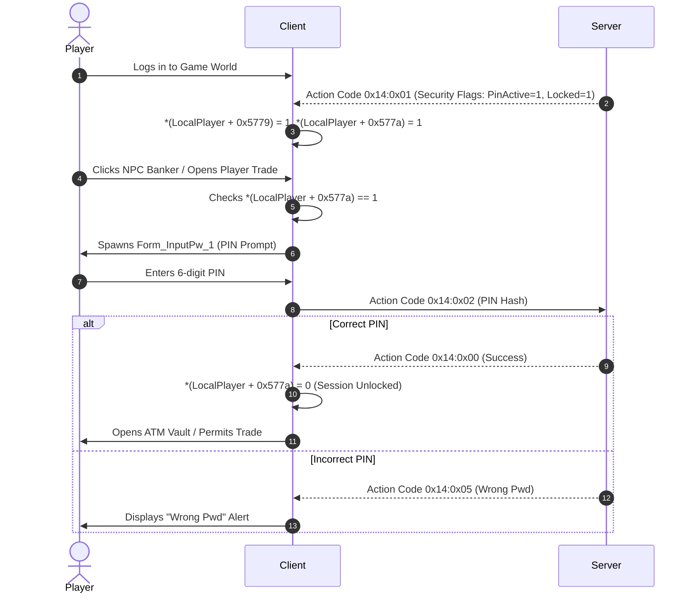

# 54 - Secondary Password Security and Account PIN Vault Specification

## 1. Architectural Overview & Source Mapping

To safeguard high-value character assets (Item Mall purchases, equipment, high-tier alchemy materials, pet contracts, and gold balances), Wonderland Online incorporates a secondary password security PIN vault. This subsystem regulates sensitive transactional events, including trade execution, ATM banking withdrawals, player vending stall creation, and equipment disposal.

The subsystem is implemented in the client via `Form_ExchangeLockChang`, `Form_InputPw_1`, and `Form_InputPw_2`.

### Subroutine Inventory & Source Locations

| Virtual Address | Subroutine Symbol | File / Unit | Purpose |
| :--- | :--- | :--- | :--- |
| `0x00175654` | `FUN_00175654` | Client Engine | Secondary PIN packet dispatcher (Opcode 20 sub-actions) |
| `0x001756bc` | `FUN_001756bc` | Client Engine | `Form_ExchangeLockChang` dialog constructor ($300 \times 440$ px) |
| `0x00175d10` | `FUN_00175d10` | Client Engine | Server PIN change response handler (`"Code changed"`, `"Wrong Pwd"`) |
| `0x00176164` | `FUN_00176164` | Client Engine | Security unlock state validator for transactional actions |
| `0x001762e0` | `FUN_001762e0` | Client Engine | Vault unlock verification handler (`+0x5779`, `+0x577a` reset) |
| `0x00176b60` | `FUN_00176b60` | Client Engine | Dynamic lock icon status controller (`Btn_Lock_1` / `Btn_UnLock_1`) |

---

## 2. Form Geometry & Security PIN Input Fields

The secondary PIN management dialog `Form_ExchangeLockChang` ($300 \times 440$ pixels) enforces a 3-tier cryptographic verification workflow.

```
+-------------------------------------------------------------+
| [Lock Icon] Secondary Security PIN Setup     [Btn_Close_S_1]|
+-------------------------------------------------------------+
|  Protect your character assets, vault, and trade sessions.  |
|                                                             |
|  Current Security PIN:                                      |
|  [ * * * * * * ] (Max 10 chars, IDField 1)                  |
|                                                             |
|  New Security PIN:                                          |
|  [ * * * * * * ] (Max 10 chars, IDField 2)                  |
|                                                             |
|  Confirm New PIN:                                           |
|  [ * * * * * * ] (Max 10 chars, IDField 3)                  |
|                                                             |
|  Security Rules:                                            |
|  - Must be 6 to 10 alphanumeric characters.                 |
|  - Cannot match primary account login password!             |
|                                                             |
|         [Btn_OK_1 (Submit)]         [Btn_Close_1 (Cancel)]  |
+-------------------------------------------------------------+
```

### Form Specifications

- **Form Name:** `Form_ExchangeLockChang`
- **Dimensions:** Width = 300 pixels, Height = `0x1b8` (440 pixels)
- **Input Fields (`param_1 + 0x3d + (1..3)*4`):**
  - Stride: $Y = \text{local}_{10} \times 0x1d + 0x5a$ ($29$ px vertical stride).
  - Maximum Character Length: **10 characters** (`FUN_00482ae0(piVar3, 10)`).
  - Password Masking: Enabled (`*(undefined1 *)(piVar3 + 0x7e) = 1`).
  - Field 1: Old / Current Secondary PIN.
  - Field 2: New Secondary PIN.
  - Field 3: Confirmation New Secondary PIN.

---

## 3. Actor Memory Layout: Security Registers

The LocalPlayer actor structure maintains dedicated security registers:

| Offset in Actor | Data Type | Field Name | Description |
| :---: | :---: | :--- | :--- |
| `+0x5779` | `uint8` | `IsSecondaryPinConfigured` | $1 =$ Account has configured secondary PIN, $0 =$ None |
| `+0x577a` | `uint8` | `IsSessionLocked` | $1 =$ Secondary PIN required, $0 =$ Unlocked for session |
| `+0x577b` | `char[7]` | `CachedPinDigest` | Active session plaintext / hash buffer (Null-terminated) |

### Session Lock Lifecycle



---

## 4. Security Rules & Server Validation Engine (`FUN_00175d10`)

When a player submits a password modification request (`Form_ExchangeLockChang`), the server evaluates strict security constraints:

### Error Code Responses (`*(char *)(param_2 + 2)`)

| Status Code | Client Alert String | Technical Condition |
| :---: | :--- | :--- |
| `0x00` | `"Code changed"` | Password change successful; persists to database |
| `0x06` | Error Code 6 Alert | Secondary password format invalid ($< 6$ characters) |
| `0x07` | `"Secure Code & Pwd must not match"` | New secondary PIN matches character login password |
| `Other` | `"Wrong Pwd"` | Old secondary PIN does not match database record |

### Protected Action Gateways

While `*(LocalPlayer + 0x577a) == 1` (Session Locked), the client blocks the following operations:
1. **Player Trade (`CY_Trade.pas`):** Blocked with `"Security lock active, unlock to trade"`.
2. **ATM Banking (`mWS_Operation.pas`):** Deposits allowed, withdrawals strictly blocked.
3. **Item Dropping / Deletion:** Dropping items on the ground is suppressed.
4. **Player Stall Opening (`HL_Shop.pas`):** Cannot deploy merchant stalls.
5. **NPC Equipment Selling:** Cannot vend gear to town merchants.

---

## 5. Wire Protocol & Network Framing

Security PIN communications are routed through **Action Code 20 (`0x14`)**.

### Security PIN Protocol Matrix

| Action Code | Sub-Opcode | Direction | Description | Payload Schema |
| :---: | :---: | :---: | :--- | :--- |
| `0x14` | `0x01` | S $\to$ C | Security Status Sync | `[IsConfigured (1B)] [IsLocked (1B)]` |
| `0x14` | `0x02` | C $\to$ S | Verify PIN (Unlock) | `[PIN Length (1B)] [PIN String]` |
| `0x14` | `0x03` | C $\to$ S | Set Initial PIN | `[PIN Length (1B)] [PIN String]` |
| `0x14` | `0x04` | C $\to$ S | Change PIN | `[Old PIN Len] [Old PIN] [New PIN Len] [New PIN]` |
| `0x14` | `0x05` | S $\to$ C | Operation Result | `[Result Code (1B)] (0=OK, 6=Format, 7=MatchesLogin)` |

---

## 6. Private Server Implementation Requirements

1. **Anti-Brute Force Protection:** Implement an exponential backoff or 3-attempt lockout per session. After 3 incorrect PIN entries, lock the character socket for 10 minutes.
2. **Secondary PIN Separation:** Store `secondary_pin` as a distinct bcrypt / SHA-256 hash in the `accounts` or `characters` database table, completely segregated from `password_hash`.
3. **Distinct Password Verification:** On PIN change (`0x14:0x04`), compare the proposed PIN against the account login password; if identical, return status `0x07` (`"Secure Code & Pwd must not match"`).
