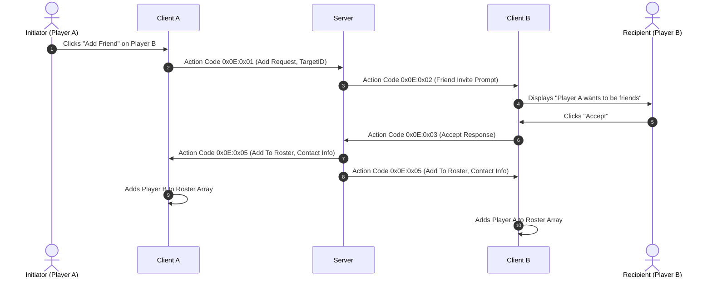

# 58 - Instant Messenger (ICQ) and Bilateral Friend Roster Specification

## 1. Architectural Overview & Source Mapping

Wonderland Online integrates a native peer-to-peer instant messaging suite modeled after vintage ICQ communications. The subsystem is implemented across Delphi units `AC_ICQ.pas`, `HL_BlackNameList.pas`, and `Kse_BlockMsg.pas`, rendered via client interface `Form_Friend_2`. The architecture manages bilateral buddy partnerships, real-time presence indicators, customizable mood broadcasts, and spam-prevention blacklists.

### Subroutine Inventory & Source Locations

| Virtual Address | Subroutine Symbol | File / Unit | Purpose |
| :--- | :--- | :--- | :--- |
| `0x00298fb4` | `FUN_00298fb4` | `AC_ICQ.pas` | `Form_Friend_2` dialog constructor and 24-slot friend/blacklist layout |
| `0x00299348` | `FUN_00299348` | `AC_ICQ.pas` | Friend interaction menu handler (whisper, mail, party invite, remove) |
| `0x002956e8` | `FUN_002956e8` | `AC_ICQ.pas` | Online / offline buddy presence status icon resolver |
| `0x00295820` | `FUN_00295820` | `HL_BlackNameList.pas` | Blacklist lookup and inbound whisper filter evaluator |
| `0x00295a14` | `FUN_00295a14` | `Kse_BlockMsg.pas` | Spam mute suppressor and blocked message drop handler |
| `0x00271342` | `FUN_00271342` | `AC_ICQ.pas` | Friend action packet dispatcher (`Action Code 0x20:0x01` / `0x0E`) |

---

## 2. Form Geometry & UI Layout

The friend roster dialog `Form_Friend_2` provides a tabbed browser toggling between mutual friends and ignored blacklisted users:

```
+-------------------------------------------------------------+
| [ICQ Flower Icon] Friend Roster & Contacts   [Btn_Close_s_1]|
+-------------------------------------------------------------+
|  [Tab: Friends (24 Max)]         [Tab: Blacklist (24 Max)]  |
|  +-------------------------------------------------------+  |
|  | [Status] Name           | Level | Element | Location  |  |
|  +-------------------------------------------------------+  |
|  | [ONLINE] Alice          | LV 45 | Water   | Welling   |  |
|  | [ONLINE] Bob            | LV 52 | Fire    | Holy Vill |  |
|  | [OFFLINE] Charlie       | LV 38 | Earth   | --        |  |
|  | [OFFLINE] Diana         | LV 60 | Wind    | --        |  |
|  | [ONLINE] Edward         | LV 15 | Water   | Kelan     |  |
|  +-------------------------------------------------------+  |
|  Showing 1 - 5 of 12 Friends        [< Prev]   [Next >]     |
|                                                             |
|  Options: [Whisper (PM)]  [Invite to Party]  [Send Mail]    |
|           [Add Friend]    [Block / Blacklist] [Delete]      |
+-------------------------------------------------------------+
```

### Form Specifications

- **Form Name:** `Form_Friend_2`
- **Capacity Limits (`FUN_00298fb4`):**
  - **Friend Roster Array (`param_1 + 0x2d4`):** Up to **24 friends** (`iVar3 = 1..24`).
  - **Blacklist Array (`param_1 + 0x270`):** Up to **24 blocked users** (`iVar3 = 1..24`).
  - **Visible Row Grid:** 5 contact cards per display page.
  - **Data Columns:**
    - `param_1 + 0x3b0`: Contact Character Name.
    - `param_1 + 0x3c8`: Contact Level.
    - `param_1 + 0x410`: Elemental Affinity icon.
    - `param_1 + 0x144`: Online Presence status indicator.

---

## 3. Contact Lifecycle & Bilateral Confirmation

Unlike unilateral social follows, Wonderland Online enforces bilateral friend handshakes:



---

## 4. Blacklist Filtering & Message Dropping (`HL_BlackNameList.pas`)

When a player adds an adversary to the blacklist:
1. The character name is committed to the local ignore buffer (`param_1 + 0x270 + index * 4`).
2. When an incoming private whisper packet (`Action Code 0x01`) arrives, `FUN_00295820` performs a case-insensitive name match against all 24 blacklist registers.
3. If a match is found:
   - The message payload is silently dropped without invoking the DirectSound notification chime or chat window logger.
   - The sender receives no bounce alert, preventing harassment escalation.

---

## 5. Wire Protocol & Network Framing

Social contacts are orchestrated through **Action Code 14 (`0x0E`)** and presence through **Action Code 32 (`0x20`)**.

### Social Operations Protocol Matrix

| Action Code | Sub-Opcode | Direction | Description | Payload Schema |
| :---: | :---: | :---: | :--- | :--- |
| `0x0E` | `0x01` | C $\to$ S | Send Friend Request | `[Target Character ID (4B)]` |
| `0x0E` | `0x02` | S $\to$ C | Inbound Request Prompt | `[Requester ID (4B)] [Requester Name]` |
| `0x0E` | `0x03` | C $\to$ S | Accept / Decline Friend | `[Requester ID (4B)] [Accept Flag (1B)]` |
| `0x0E` | `0x04` | C $\to$ S | Remove / Unfriend | `[Target Character ID (4B)]` |
| `0x0E` | `0x05` | S $\to$ C | Sync Friend Record | `[ID (4B)] [LV (1B)] [Element (1B)] [Job (1B)] [Name]` |
| `0x0E` | `0x06` | C $\to$ S | Add to Blacklist | `[Target Name Len] [Target Name String]` |
| `0x0E` | `0x07` | C $\to$ S | Remove from Blacklist | `[Target Name Len] [Target Name String]` |
| `0x20` | `0x01` | S $\to$ C | Presence Change Notice | `[Friend ID (4B)] [Status (1B)] (1=Online, 0=Offline)` |

---

## 6. Private Server Implementation Requirements

1. **Bilateral Database Persistence:** Mutual friendship must be stored in the database (`friends` table) with bidirectional pairing records (`(CharA, CharB)` and `(CharB, CharA)`).
2. **Presence Change Multicast:** On socket connection or graceful disconnection, lookup all online characters having the connecting user on their friend list and dispatch presence update packet `0x20:0x01`.
3. **Capacity Clamping:** Enforce a hard ceiling of 24 friends and 24 blacklisted users per character account to prevent buffer overruns in client memory arrays.
