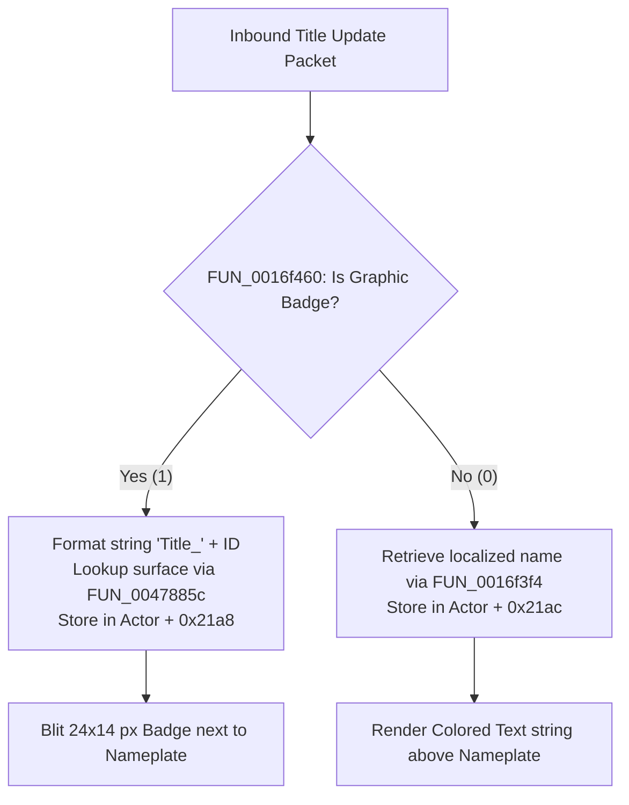

# 59 - Player Title Management and Achievement Honor Engine Specification

## 1. Architectural Overview & Source Mapping

Wonderland Online incorporates an honor and achievement classification system known as **Player Titles** (稱號系統). Titles serve as status symbols rendered prominently above character sprites, bestowing passive attribute bonuses (ATK, DEF, MATK, MDEF, HP, SP, SPD) when equipped.

The subsystem is implemented in Delphi unit `NJ_PlayerTitleManager.pas`, controlling title unlocking, text versus graphic badge rendering, and multi-actor network replication.

### Subroutine Inventory & Source Locations

| Virtual Address | Subroutine Symbol | File / Unit | Purpose |
| :--- | :--- | :--- | :--- |
| `0x0016f4c8` | `FUN_0016f4c8` | `NJ_PlayerTitleManager.pas` | Primary Title packet receiver and multi-actor field deserializer |
| `0x0016f460` | `FUN_0016f460` | `NJ_PlayerTitleManager.pas` | Title type classifier ($0 =$ Plain Text, $1 =$ Graphic Icon Badge) |
| `0x0016f3f4` | `FUN_0016f3f4` | `NJ_PlayerTitleManager.pas` | Text title string formatter and localization formatter |
| `0x0016f870` | `FUN_0016f870` | `NJ_PlayerTitleManager.pas` | 256-entry title database loader (`0x1c38` bytes, 28 bytes per title) |
| `0x00159071` | `FUN_00159071` | `NJ_PlayerTitleManager.pas` | Graphic badge surface texture binder (`"Title_"` + ID) |

---

## 2. Actor Memory Layout: Title Registers

Titles are replicated across three distinct actor representation structures:

### 1. Local Player Actor (`PTR_DAT_004c9918`)

| Memory Offset | Data Type | Field Name | Description |
| :---: | :---: | :--- | :--- |
| `+0x21a4` | `uint8` | `ActiveTitleID` | Numeric identifier of currently equipped title |
| `+0x21a8` | `uint32` | `BadgeSurfaceHandle` | DirectDraw surface handle for graphic badge (`Title_X`) |
| `+0x21ac` | `char*` | `TextTitleString` | Formatted Unicode/BIG5 string for text title |

### 2. Party Member Structure (`PTR_DAT_004c9754`)

| Memory Offset | Data Type | Field Name | Description |
| :---: | :---: | :--- | :--- |
| `+0xca` | `uint8` | `PartyMemberTitleID` | Title ID of remote party member |
| `+0xcc` | `uint32` | `PartyBadgeSurface` | DirectDraw badge surface handle |
| `+0xd0` | `char*` | `PartyTextTitle` | Text title display string |

### 3. Visible World Player Actor (`PTR_DAT_004c9134`)

| Memory Offset | Data Type | Field Name | Description |
| :---: | :---: | :--- | :--- |
| `+0x21a4` | `uint8` | `WorldActorTitleID` | Title ID of visible player in render grid |
| `+0x21a8` | `uint32` | `WorldBadgeSurface` | DirectDraw badge surface handle |
| `+0x21ac` | `char*` | `WorldTextTitle` | Text title display string |

---

## 3. Title Registry Architecture (28-Byte Stride)

The title database is loaded into a contiguous buffer of **`0x1c38` bytes** in `FUN_0016f870`, accommodating **256 master titles** with an exact stride of **28 bytes (`0x1C`)**:

| Offset | Type | Field Name | Description |
| :---: | :---: | :--- | :--- |
| `+0x00` | `uint8` | `TitleID` | Primary index ($1..255$, $0 =$ None) |
| `+0x01` | `uint8` | `IsGraphicBadge` | $1 =$ Render graphic bitmap (`Title_X`), $0 =$ Plain text |
| `+0x02` | `char[16]`| `TitleName` | Localized title display text |
| `+0x12` | `int16` | `BonusATK` | Physical attack modifier |
| `+0x14` | `int16` | `BonusDEF` | Physical defense modifier |
| `+0x16` | `int16` | `BonusMATK` | Magic attack modifier |
| `+0x18` | `int16` | `BonusMDEF` | Magic defense modifier |
| `+0x1A` | `int16` | `BonusSPD` | Turn-order combat speed modifier |

---

## 4. Title Rendering & Graphic Badges (`FUN_0016f4c8`)

When rendering titles above a character's nameplate:



---

## 5. Wire Protocol & Network Framing

Title updates communicate via **Action Code 8 (`0x08`)** or **Action Code 23 (`0x17`)**.

### Client-Server Title Frame Schema

```
+---------------+---------------+-------------------------------+---------------+
| Action (0x08) | Sub-Op (0x0E) | Target Character ID (4 Bytes) | Title ID (1B) |
+---------------+---------------+-------------------------------+---------------+
```

| Field Offset | Type | Length | Description |
| :---: | :---: | :---: | :--- |
| `0x00` | `uint8` | 1 byte | Action Code `0x08` (Character Progression) |
| `0x01` | `uint8` | 1 byte | Sub-Opcode `0x0E` (Title Replicate) |
| `0x02` | `uint32` | 4 bytes | Character ID of target player (Little-Endian) |
| `0x06` | `uint8` | 1 byte | Newly equipped Title ID ($0 =$ Dismount Title) |

---

## 6. Private Server Implementation Requirements

1. **Broadcast Scope:** Title changes must be multicast to all surrounding players within the $271$ pixel spatial grid as well as all active party members.
2. **Passive Bonus Application:** When equipping or changing titles, immediately recalculate the character's derived combat ratings (`ATK`, `DEF`, `SPD`) and push stat deltas via `Action Code 23`.
3. **Database Schema:** Persist unlocked player titles in a `character_titles` table (`char_id`, `title_id`, `unlock_date`, `is_active`).
