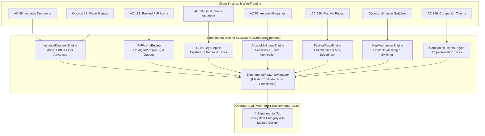

# Technical Specification 19: Experimental Features Lab and Gap Implementation

## 1. Architectural Overview

This document details the architectural design, protocol specifications, data models, and administration interfaces for the **Experimental Features Lab** in Wonderland Online Private Server. The experimental subsystem bridges the documented protocol gaps from `docs/15_gap_analysis_and_feature_roadmap.md` and the 99-specification reverse-engineering catalog in `decompiled/`.

---

## 2. Master Experimental Controller (`ExperimentalFeaturesManager`)

- **Namespace:** `Game.Experimental`
- **Class:** `ExperimentalFeaturesManager`
- **Access Pattern:** Singleton via `ExperimentalFeaturesManager.Instance` or `cGlobal.Experimental`.
- **Persistence Path:** `Data/experimental_settings.ini`
- **Runtime Toggles:**
  - `EnableInstanceDungeons`: Boolean toggle gating AC 85 dispatch and Opcode 17 wave transitions.
  - `EnablePvPArena`: Boolean toggle gating AC 183 queue entries and matchmaking iterations.
  - `EnableGuildSiege`: Boolean toggle gating AC 184 territory vouchers and castle damage.
  - `EnableArcadeMinigames`: Boolean toggle gating AC 57 standalone arcade sessions.
  - `EnableFestivalRaces`: Boolean toggle gating AC 226 race checkpoint timing.
  - `EnableMapMechanisms`: Boolean toggle gating Opcode 16 switch manipulation.
  - `EnableCompanionTalents`: Boolean toggle gating AC 199 pet talent allocation.

---

## 3. Subsystem Specifications

### 3.1 Instance Dungeons & Wave Stages (`InstanceDungeonEngine`)
- **Action Code:** `AC 85` (Subcodes 1, 2, 3, 4, 5, 6, 10, 11, 13)
- **Script Signal:** `Eve.emg` Opcode 17 (Wave Advancement)
- **Target Maps:** Maps 30000+ (e.g. Map 30001 "20-Round Challenge", Map 30010 "12 Constellation Palaces")
- **Room Lifecycle:**
  - `CreateRoom(Player leader, string roomName, ushort mapId, byte maxMembers)`: Allocates new `InstanceRoom`, binds leader, sets initial wave to 1.
  - `JoinRoom(Player player, uint roomId)`: Enforces room capacity ($\le 4$), validates non-active state, synchronizes member roster.
  - `OnWaveSignal(Player player, ushort p1, ushort p2)`: Triggered by Opcode 17 in `EveEventInterpreter`. Increments `CurrentWave`. Upon reaching `MaxWaves`, dispatches victory banner (`AC 85:12`) and awards trial items (Item ID 23001).
- **Exceptions & Safeguards:** Prevents member joining mid-battle; auto-disbands empty rooms upon leader disconnect.

### 3.2 Ranked PvP Matchmaking & Elo Arena (`PvPArenaEngine`)
- **Action Code:** `AC 183` (Subcodes 1, 2, 11, 17) & `AC 186`
- **Rating Formula:** Standard Elo rating with development coefficient $K = 32$:
  $$E_A = \frac{1}{1 + 10^{(R_B - R_A)/400}}$$
  $$R'_A = R_A + K \times (S_A - E_A)$$
- **Matchmaking Engine:** Periodic queue evaluation. Expands acceptable rating threshold $\Delta R = 150 + (T_{wait} \times 15)$ to guarantee match generation while maintaining competitive balance.
- **Tiers:** Bronze ($<1300$), Gold ($1300..1599$), Diamond ($1600..1999$), Grandmaster ($\ge 2000$).

### 3.3 Guild Siege Warfare & Territory Control (`GuildSiegeEngine`)
- **Action Code:** `AC 184` & `AC 92`
- **Territories:**
  - `Territory 1`: Kelan Fortress (Map 10001, Crystal HP: 10,000)
  - `Territory 2`: Holy City Bastion (Map 11001, Crystal HP: 15,000)
  - `Territory 3`: Kyoto Citadel (Map 12001, Crystal HP: 20,000)
- **Combat Resolution:** Attacking players deal direct damage to the fortress crystal. The guild accumulating the highest total damage captures castle ownership upon crystal breakdown ($HP = 0$).
- **Economy & Buffs:** Occupying guilds collect daily accumulated tax gold and receive passive stat buffs (+5% per territory held).

### 3.4 Arcade Carnival Minigames (`ArcadeMinigameEngine`)
- **Action Code:** `AC 57` (Subcodes 1, 2)
- **Supported Modules:**
  - Claw Machine (`cMZ_Catcher`)
  - Rhythm Boxing (`StrengthBarFrame`)
  - Whack-A-Mole (`HitMouse`)
  - Dig Hole (`MiniGame_DigHole_Form`)
  - Gobang Gomoku (`yRE_Chess`)
- **Anti-Cheat:** Validates submitted score limits against game-specific maximum physical thresholds before granting EXP and Carnival Prize Tickets (Item ID 24001).

### 3.5 Seasonal Festival Races (`FestivalRaceEngine`)
- **Action Code:** `AC 226` (Subcodes 1, 2, 3)
- **Validation Pipeline:** Enforces ordered checkpoint sequence ($CP_0 \rightarrow CP_1 \rightarrow \dots \rightarrow CP_n$) within proximity radius (200px) and calculates elapsed time against track minimum lap velocity ($T_{min}$) to eliminate teleport speedhacking.

### 3.6 Map Mechanisms & Puzzle Switches (`MapMechanismEngine`)
- **Script Signal:** `Eve.emg` Opcode 16 (38 occurrences)
- **Execution:** Toggles switch state, broadcasts lever animation frame (`AC 22:1 Action 0 vs 1`), unblocks associated obstacle doors (`AC 22:4`), and unfreezes player movement (`AC 20:8`, `AC 5:4`).

### 3.7 Companion Pet Specialization Trees (`CompanionTalentsEngine`)
- **Action Code:** `AC 199` (Subcode 4)
- **Specialization Paths:**
  1. `Combat`: Physical attack and critical strike multiplier.
  2. `Guardian`: Defense, maximum HP pool, and barrier absorption.
  3. `Mystic`: Magical attack, maximum SP pool, and recovery efficiency.
  4. `Swift`: Movement speed and evasion rating.

---

## 4. Administration Cockpit (`MainForm1.ExperimentalTab.cs`)

The operator interface is integrated into `tabControl3` and the modern categorized navigation bar under **Experimental Lab**:
1. **Executive Status Header:** Real-time counters showing active dungeons, queued gladiators, siege war state, and active arcade sessions with 1-click global refresh.
2. **Master Toggles Panel:** Live checkboxes for all 7 feature domains with instant effect and persistent disk commit.
3. **Instance Dungeons Grid:** Room inspection, 1-click test dungeon creation, and manual wave progression (Opcode 17 simulation).
4. **Ranked PvP Splitter:** Side-by-side queue monitor and Elo leaderboard with manual matchmaking trigger.
5. **Guild Siege Dashboard:** Visual progress bars for fortress crystal health across all 3 territories with war start/end controllers and crystal damage simulation.
6. **Carnival Sessions View:** Recent session telemetry, score auditing, and reward verification.
7. **Festival Race Monitor:** Track catalog, checkpoint details, and lap time benchmarks.
