# Technical Specification 20: Extended Experimental Features and Decompiled Gap Census

## 1. Executive Summary & Gap Census

Following the baseline implementation of the first tier of experimental engines (Instance Dungeons, Ranked PvP, Guild Siege, Carnival Minigames, Festival Races, Map Mechanisms, Companion Talents in `docs/19_experimental_features_and_gap_implementation.md`), this document establishes the census and technical architecture for the remaining 10 feature systems identified in the 99-specification reverse-engineering catalog in `decompiled/`.

Each of these systems is designed as an autonomous, modular engine within `Game.Experimental` in `wlo.pserver.core`, wired directly to its corresponding network wire Action Code protocol and surfaced in the GUI `🧪 Experimental` administrative cockpit.

```mermaid
flowchart TD
    subgraph DecompiledSpecs ["Decompiled Specs & Wire Protocols"]
        Spec82["AC 82 / Spec 57, 99: Community Bulletin & Guild Notice Board"]
        Spec76["AC 76 / Spec 39, 76: Church Charity Tithe & Divine Karma"]
        Spec40["AC 40 / Spec 17, 40: Equipment Wear, Repair & Potential Forge"]
        Spec41["AC 41, 70 / Spec 41, 70: Gobang Chess & Street Wager Ante"]
        Spec90["AC 90 / Spec 43: Fishing, Bait Consumption & Aquaculture"]
        Spec44["AC 44 / Spec 44: Hot Spring Bathing & Rest Vitality"]
        Spec24["AC 24 / Spec 54, 73: Secondary PIN Vault & Anti-Theft"]
        Spec53["AC 53, 94 / Spec 53, 94: Overworld Player Stall & Pet Bazaar"]
        Spec88["AC 88 / Spec 29, 88: Dynamic Weather & Day-Night Ambient"]
        Spec84["AC 84, 86 / Spec 28, 42: Vehicle Fuel, Mount Durability & Sea Sailing"]
    end

    subgraph ExperimentalCore ["Game.Experimental Engine Architecture"]
        BulletinEng["CommunityBulletinEngine"]
        CharityEng["ChurchCharityEngine"]
        ForgeEng["EquipmentForgeEngine"]
        GobangEng["GobangWagerEngine"]
        FishingEng["AquacultureFishingEngine"]
        HotSpringEng["HotSpringBathingEngine"]
        PinVaultEng["SecondaryPinVaultEngine"]
        StallEng["PlayerStallBazaarEngine"]
        WeatherEng["DynamicWeatherLightingEngine"]
        VehicleEng["VehicleTransportEngine"]
        MasterMgr["ExperimentalFeaturesManager (Master Controller & Persistence)"]
    end

    subgraph OperatorCockpit ["Admin GUI (MainForm1.ExperimentalTab.cs)"]
        UI_Bulletin["Bulletin Board Manager"]
        UI_Charity["Church Karma & Tithes"]
        UI_Forge["Forge & Durability Bench"]
        UI_Gobang["Gobang Wager Tables"]
        UI_Fishing["Aquaculture & Catch Rates"]
        UI_HotSpring["Hot Spring Recovery Monitor"]
        UI_PinVault["PIN Vault Security Inspector"]
        UI_Stall["Overworld Bazaar Inspector"]
        UI_Weather["Weather & Lighting Controls"]
        UI_Vehicle["Vehicle Fleet & Fuel Manager"]
    end

    Spec82 --> BulletinEng --> UI_Bulletin
    Spec76 --> CharityEng --> UI_Charity
    Spec40 --> ForgeEng --> UI_Forge
    Spec41 --> GobangEng --> UI_Gobang
    Spec90 --> FishingEng --> UI_Fishing
    Spec44 --> HotSpringEng --> UI_HotSpring
    Spec24 --> PinVaultEng --> UI_PinVault
    Spec53 --> StallEng --> UI_Stall
    Spec88 --> WeatherEng --> UI_Weather
    Spec84 --> VehicleEng --> UI_Vehicle

    BulletinEng & CharityEng & ForgeEng & GobangEng & FishingEng & HotSpringEng & PinVaultEng & StallEng & WeatherEng & VehicleEng --> MasterMgr
```

---

## 2. Comprehensive Census of the 10 Extended Features

### 2.1 Feature 1: Community Blackboard & Guild Notice Board (`AC 82` & Spec 57/99)
- **Protocol Action Code:** `AC 82` (Subcodes 7: Post Message, 8: Request Tab, 9: Open Message, 11: Write Board)
- **Functional Description:** Manages global and guild-specific community bulletin message boards (`Form_BlackBoard` / `Form_ArmyGrounpInfo_1`). Players post notices, announcements, and recruitment messages with author timestamps and authority checks.
- **Engine Class:** `CommunityBulletinEngine`

### 2.2 Feature 2: Church Charity Tithe, Divine Blessings & Karma (`AC 76` & Spec 39/76)
- **Protocol Action Code:** `AC 76` (Subcodes 1: Query Tithe, 2: Donate Gold, 3: Receive Blessing)
- **Functional Description:** In-game church charity collection box. Players donate gold to earn positive Karma points. High karma unlocks divine blessings (+10% EXP boost, +500 Max HP shield, revival penalty mitigation).
- **Engine Class:** `ChurchCharityEngine`

### 2.3 Feature 3: Equipment Durability Wear, Repair Hammers & Potential Forge (`AC 40` & Spec 17/40)
- **Protocol Action Code:** `AC 40` & `form_NPCUpgrade`
- **Functional Description:** Tracks equipment wear per combat round. Dispatches broken item warnings when durability reaches 0. Supports repair hammers for durability restoration and forging potential upgrades (+1 to +10) with risk/reward progression curves.
- **Engine Class:** `EquipmentForgeEngine`

### 2.4 Feature 4: Gobang (Gomoku) Chess & Street Wager Ante (`AC 41` / `AC 70` & Spec 41/70)
- **Protocol Action Code:** `AC 41` (15x15 board state) & `AC 70` (Wager ante escrow)
- **Functional Description:** Turn-based 15x15 Gomoku chess board engine (`yRE_Chess`). Validates 5-in-a-row win conditions (horizontal, vertical, diagonal), locks ante stakes in server escrow, and awards prize pools to victorious players.
- **Engine Class:** `GobangWagerEngine`

### 2.5 Feature 5: Fishing, Aquaculture Dynamics & Catch Tables (`AC 90` & Spec 43)
- **Protocol Action Code:** `AC 90` (Subcode 1: Cast Rod, Subcode 2: Reel/Catch, Subcode 3: Cancel)
- **Functional Description:** Dynamic fishing engine factoring water environment (Freshwater, Saltwater, Deep Ocean), equipped fishing rod tier, bait consumption (Earthworms, Shrimps, Special Lures), and random catch loot tables with fish weights and treasure chests.
- **Engine Class:** `AquacultureFishingEngine`

### 2.6 Feature 6: Hot Spring Bathing & Rest Vitality Recovery (`AC 44` & Spec 44)
- **Protocol Action Code:** `AC 44` (Subcode 1: Enter Spring, Subcode 2: Rest Tick, Subcode 3: Exit Spring)
- **Functional Description:** Hot spring relaxation engine. Validates equipped towel gear, transitions character model to bathing pose (`*(actor + 0x20eb) = 1`), and pulses periodic HP/SP restoration ticks (+5% HP/SP every 5 seconds).
- **Engine Class:** `HotSpringBathingEngine`

### 2.7 Feature 7: Secondary PIN Vault & Anti-Theft Security (`AC 24` & Spec 54/73)
- **Protocol Action Code:** `AC 24` (Subcode 1: Set PIN, Subcode 2: Validate PIN, Subcode 5: Security Unlock)
- **Functional Description:** 6-digit secondary password vault protecting sensitive actions: player-to-player trade, ground dropping, high-tier alchemy, and character disposal. Locks session for 15 minutes after 3 consecutive failed attempts.
- **Engine Class:** `SecondaryPinVaultEngine`

### 2.8 Feature 8: Overworld Player Stall Vending & Pet Bazaar (`AC 53` / `AC 94` & Spec 53/94/97)
- **Protocol Action Code:** `AC 53` & `AC 94` (Stall opening, item listing, purchasing, stall closing)
- **Functional Description:** Overworld player kiosk vending (`Form_Stall`). Players pitch storefronts in designated bazaar maps (Map 10000, Map 11000), offering up to 10 items and 4 companion pets for sale with tax collection and instant buyer delivery.
- **Engine Class:** `PlayerStallBazaarEngine`

### 2.9 Feature 9: Dynamic Weather Simulation & Day-Night Ambient Lighting (`AC 88` & Spec 29/88)
- **Protocol Action Code:** `AC 88` (Weather broadcast & palette tinting)
- **Functional Description:** Time-of-day simulation engine cycling through Dawn (06:00), Noon (12:00), Dusk (18:00), and Midnight (00:00). Triggers dynamic weather patterns (Clear, Gentle Rain, Heavy Thunderstorm, Snow Drift) with ambient lighting packets broadcast to all clients.
- **Engine Class:** `DynamicWeatherLightingEngine`

### 2.10 Feature 10: Vehicle Fleet, Fuel Consumption & Mount Durability (`AC 84` / `AC 86` & Spec 28/42)
- **Protocol Action Code:** `AC 84` (Fuel/Repair) & `AC 86` (Ocean Navigation)
- **Functional Description:** Manages the 29-vehicle taxonomy parsed from `data\TrafficSetting.txt` (Raft, Motorboat, Flying Carpet, Airship, Submarine). Tracks fuel levels, speed modifiers, terrain passage gates (Land, Water, Sky), multi-passenger party seats, and repair costs.
- **Engine Class:** `VehicleTransportEngine`

---

## 3. Data Contracts & Parameter Specifications

### 3.1 `CommunityBulletinEngine`
- `PostMessage(Player author, uint guildId, string title, string content, bool isGlobal)` -> `BulletinPost`
- `GetPosts(uint guildId, bool includeGlobal)` -> `IReadOnlyList<BulletinPost>`
- `DeletePost(Player requester, uint postId)` -> `bool`

### 3.2 `ChurchCharityEngine`
- `Donate(Player donor, int goldAmount)` -> `KarmaRecord` (increases karma by 1 point per 1,000G, capped at 1,000 karma)
- `GetBlessing(Player player)` -> `BlessingStatus` (+10% EXP, +500 Max HP, active for 60 minutes)

### 3.3 `EquipmentForgeEngine`
- `ApplyCombatWear(Player player, byte wearAmount = 1)` -> `List<WearReport>` (reduces durability on worn weapons/armor)
- `RepairEquipment(Player player, byte slot, ushort hammerItemId)` -> `bool`
- `ForgeUpgrade(Player player, byte slot, ushort catalystItemId)` -> `ForgeResult` (success, failure, or downgrade)

### 3.4 `GobangWagerEngine`
- `CreateMatch(Player host, Player challenger, int goldWager)` -> `GobangMatch`
- `PlaceStone(uint matchId, Player player, int x, int y)` -> `MoveResult` (checks 5-in-a-row)

### 3.5 `AquacultureFishingEngine`
- `StartFishing(Player player, ushort rodItemId, ushort baitItemId)` -> `bool`
- `CatchFish(Player player)` -> `CatchResult` (resolves fish item ID, weight, and EXP)

### 3.6 `HotSpringBathingEngine`
- `EnterHotSpring(Player player, ushort mapId)` -> `bool` (validates towel, sets bathing state `*(actor + 0x20eb) = 1`)
- `PulseRestTick(Player player)` -> `RestTickResult` (+5% HP/SP restoration)
- `ExitHotSpring(Player player)` -> `bool`

### 3.7 `SecondaryPinVaultEngine`
- `SetPin(Player player, string pin)` -> `bool` (validates 6 digits)
- `VerifyPin(Player player, string pin)` -> `bool` (enforces 3-strike lockout)
- `IsActionLocked(Player player)` -> `bool`

### 3.8 `PlayerStallBazaarEngine`
- `OpenStall(Player vendor, string stallName, List<StallItem> items)` -> `PlayerStall`
- `PurchaseItem(Player buyer, uint vendorCharId, byte slotIndex)` -> `bool`
- `CloseStall(Player vendor)` -> `bool`

### 3.9 `DynamicWeatherLightingEngine`
- `SetWeather(ushort mapId, WeatherType weather)` -> `void` (broadcasts AC 88 to map)
- `AdvanceTimeOfDay()` -> `TimeOfDayState` (broadcasts ambient palette sync)

### 3.10 `VehicleTransportEngine`
- `MountVehicle(Player driver, ushort vehicleItemId)` -> `bool`
- `ConsumeFuel(Player driver, int distanceTravelled)` -> `int` (remaining fuel)
- `RefuelVehicle(Player driver, ushort fuelItemId)` -> `bool`

---

## 4. Administrative GUI Cockpit Integration

The `MainForm1.ExperimentalTab.cs` interface expands to accommodate dedicated sub-module management tabs:
1. **Master Control Plane:** 17 individual system switches with disk commit.
2. **Community Bulletin:** Post moderation, global broadcast announcements, and message history.
3. **Church Charity & Karma:** Tithe vault inspector, karma leaderboard, and blessing dispensor.
4. **Equipment Forge Bench:** Durability decay monitor, repair tester, and forging probability tuner.
5. **Gobang Chess Tables:** Active match viewer, wager escrow tracker, and move simulator.
6. **Aquaculture & Fishing:** Catch table configurator, zone loot tables, and test angling simulator.
7. **Hot Spring Recovery:** Active bather count, vitality tick logger, and zone occupancy.
8. **Secondary PIN Vault:** Security status inspector, failed attempt resets, and lockout overrides.
9. **Overworld Bazaar:** Active stalls list, item catalog viewer, and sales transaction auditing.
10. **Weather & Lighting:** Time-of-day clock (Dawn/Noon/Dusk/Night) and dynamic weather triggers (Snow/Rain/Clear).
11. **Vehicle Fleet:** 29-vehicle specs inspector, fuel gauges, and passenger seat assignments.
