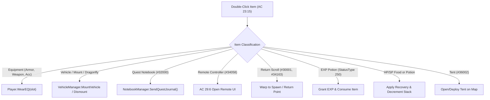

# Inventory Item Dispatching and Mount Lifecycle Specification

## Overview

This specification details the item classification, dispatching engine, and mount lifecycle implemented in `Src/Network/ActionCodes/AC23.cs` and `wlo.pserver.core/Game/PlayerRelated/Vehicle.cs`. It resolves the defect where double-clicking inventory items (equipment, mounts, potions, utility tools) failed to execute.

---

## 1. Item Double-Click Architecture (`AC 23:15` vs `AC 23:96`)

### 1.1 Client Dispatch Discrepancy

In the native Wonderland Online client:
- Right-clicking food or potions to consume triggers `AC 23:96` (`Use item from inventory`).
- Double-clicking items in the inventory bag (equipment, mounts, starter tools, scrolls, EXP potions) triggers `AC 23:15`:
  ```
  Client -> Server: AC 23:15
  Byte 0..3: Header (0xF4, 0x44, LengthL, LengthH)
  Byte 4:    0x17 (ActionCode 23: Inventory)
  Byte 5:    0x0F (SubCode 15: Quick Action / Double-Click)
  Byte 6:    Slot (1..50)
  Byte 7:    Count (default 1)
  Byte 8..9: Target ID (optional target companion or player ID)
  ```
- Previously, `AC 23:15` only checked if an item had HP/SP recovery values or was a personal tent (`item.Special == 30`). Equipment, vehicles, EXP potions, quest notebooks, and remote controllers were ignored.

---

## 2. Dispatch Routing Engine (`AC23.Recv15`)

When `AC 23:15` is received, the item type is resolved via `item.ItemType` from `PhxItemInfo` and routed to the corresponding subsystem:



### 2.1 Equipment Wear Dispatching
If `item.ItemType` matches any equipment classification (Weapon, Head, Body, Arm, Foot, Accessory), `Recv15` invokes `p.WearEQ(slot)`. This triggers:
- Client packet `AC 23:11` (Item equipped)
- Stat attribute re-calculation
- Visual avatar gear updates

### 2.2 Vehicle & Mount Lifecycle
If `item.ItemType == eItemType.Vehicle`, or item ID is in the vehicle range `48010..48045`, or is Bamboo Dragonfly `34169`:
- If `p.ActiveVehicleID == itemId`, invokes `VehicleManager.DismountVehicle(p)`.
- If unmounted, invokes `VehicleManager.MountVehicle(p, slot)`.
- Server updates `ActiveVehicleID` and broadcasts `AC 20:10` speed adjustments.

### 2.3 Special Tools & Utility Items
- **Adventurer's Notebook (`32000`):** Calls `NotebookManager.SendQuestJournal(p)` to render active and completed quests.
- **Remote Controller (`34058`):** Emits `Tools.FromFormat("bb", 29, 6)` to open the combat auto-battle settings window.
- **Return Scrolls (`30001`, `34163`):** Resolves player spawn coordinates (`p.SaveMapID`, `p.SaveX`, `p.SaveY`) and teleports player to safety.
- **EXP Potions (`StatusType == 250`):** Adds base EXP to player or targeted pet, deducts 1 from stack, and plays level-up checks.

---

## 3. Vehicle Definition Whitelist Expansion (`Vehicle.cs`)

In `Vehicle.TryGetVehicle`:
The whitelist was expanded to accommodate utility starter mounts and flight vehicles that do not share the standard vehicle type flag:

```csharp
if (item.ItemType == eItemType.Vehicle || 
    item.ItemID == 34169 || // Bamboo Dragonfly
    (item.ItemID >= 48010 && item.ItemID <= 48045)) // Starter Vehicles & Mounts
{
    // Mount processing enabled
}
```

---

## 4. Client Gathering / Fishing State Clearing (`AC 23:54` / `0x17:0x36`)

### 4.1 Protocol Analysis & Defect Diagnosis
In `aLogin_decompiled.c` (`FUN_0046a8e4`, lines 445274, 464979, 465107), whenever the client clears an active fishing or gathering mutex (`LocalPlayer + 0x20b5 = 0`), it transmits `FUN_002d6ad8(..., 0x17, 0x36, 0)`. On the wire, this manifests as a 6-byte packet:
```
F4 44 02 00 17 36
```
Where `0x17 = 23` (ActionCode 23) and `0x36 = 54` (SubCode 54).

Previously, `AC23.Recv54` erroneously labeled this packet as `"Request Item Mall Catalog List"` and invoked:
```csharp
ItemMallManager.SendCatalog(p, isBonus: false);
ItemMallManager.SendCatalog(p, isBonus: true);
ItemMallManager.SendPointBalance(p);
```
Consequently, whenever a player moved, closed a dialogue balloon, or cancelled fishing, the server flooded the client with `AC 75:1` (Points Mall, 137 items), `AC 75:10` (Bonus Mall, 62 items), and `AC 75:3` (Point Balance). This caused client frame hitches and packet queue flooding at the conclusion of dialogues (e.g. Robinson's dialogue on Rhode Island Beach).

### 4.2 Technical Resolution
`AC23.Recv54` was refactored to simply clear server-side gathering and fishing flags without transmitting any Item Mall catalog packets:
```csharp
void Recv54(Player p, RecievePacket r)
{
    try
    {
        p.Fishing = false;
        Game.Crafting.GatheringManager.StopGathering(p);
        DebugSystem.Write($"[AC23.Recv54] Cleared fishing/gathering state for {p.CharName}");
    }
    catch (Exception t) { Console.WriteLine(t); }
}
```
Item Mall catalogs are officially sent once during character login initialization via `WorldServer.cs:539` (`ItemMallManager.SendInitialMallSync`), completely eliminating spurious catalog re-transmissions during gameplay.
