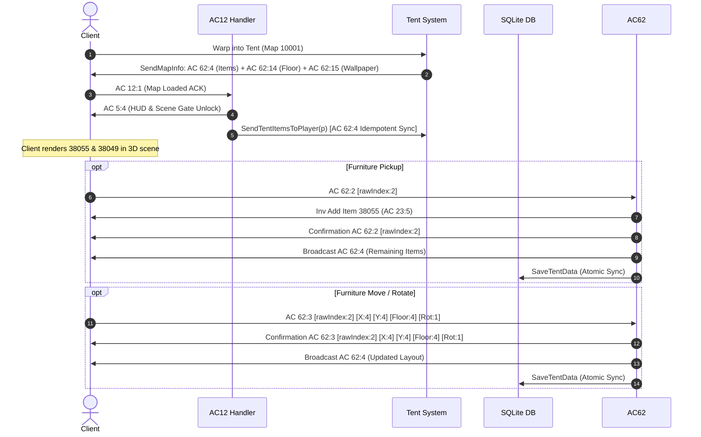

# Tent Furniture Native Reverse-Engineered Lifecycle & Spatial Management Specification

## 1. Architectural Overview

The tent housing furniture subsystem in Wonderland Online enables private player interiors (virtual map `10001`) to instantiate starter utility appliances, dynamically rearrange and rotate placed entities across isometric floor coordinates, and pack placed furniture pieces back into the player's primary inventory bag.

Reverse-engineering the client executable (`aLogin.exe`) revealed that tent housing entities are managed by a dedicated client Housing Manager (`*(DAT_004c9900 + 0x51b4)`) driven entirely by **Action Code 62** (`0x3E`), routed through `0x301ca2` -> [`FUN_003fd644`](file:///D:/GitHub/Wonderland-Private-Server/decompiled/aLogin_decompiled.c#L417897). Previously attempted `AC 23:3` packets represented ground item drops in world maps, not tent furniture. This document details the exact client-native wire protocol, 57-byte entity structure, 1-based index translation, and database persistence mechanisms.

---

## 2. Default Housing Furniture Configuration

Every player's private tent interior spawns with two essential starter crafting and utility appliances upon account/tent creation:

| Item ID | Technical Item Name | In-Game Asset Name | Functional Description | Default Coordinates $(X, Y, \text{Floor}, \text{Rot})$ |
|:---|:---|:---|:---|:---|
| `38055` | `Resource Recycling` | Resource Recycling ("Çöp Kovası") | Housing recycling receptacle / trash disposal unit | `(43, 42, 0, 0)` |
| `38049` | `Work Platform` | Work Platform ("Çalışma Tezgahı") | Low workbench appliance for fundamental tool manufacturing | `(45, 42, 0, 0)` |

### 2.1 Initialization & Persistence Lifecycle
* **Instantiation Point:** [`Tent.InitializeDefaultItems()`](file:///D:/GitHub/Wonderland-Private-Server/wlo.pserver.core/Game/PlayerRelated/Tent/Tent.cs) places Item `38055` and Item `38049` into `_tentObjects`.
* **Database Resolution:** [`CharacterDataBase.LoadTentData`](file:///D:/GitHub/Wonderland-Private-Server/wlo.pserver.core/DataBase/CharacterDataBase.cs) inspects existing housing records:
  - If `chartent_items` records exist, they are loaded into `player.Tent.TentObjects`.
  - If `chartent` already exists but `chartent_items` is empty, it reflects that the player deliberately retrieved all furniture into inventory (`TentObjects.Clear()`).
  - If `chartent` does not exist (new player), default initial items are persisted atomically to `chartent_items` via `SaveTentData(player, force: true)`.

---

## 3. Native Network Wire Protocol (`Action Code 62`)

All tent furniture manipulation packets use **Action Code 62** (`0x3E`), routed through [`AC62.cs`](file:///D:/GitHub/Wonderland-Private-Server/Src/Network/ActionCodes/AC62.cs) and processed by client handler `FUN_003fd644`:

```
+---------------+-----------------------+---------------------------------------------------------------+
| Packet Code   | Direction             | Payload Structure & Field Semantics                           |
+---------------+-----------------------+---------------------------------------------------------------+
| AC 62:4       | Server -> Client      | [OwnerCharID:4 LE] + N * [Index:2 LE + ItemData:57]           |
| AC 62:1       | Client -> Server      | [Bag:1] [Slot:1] [X:4 LE] [Y:4 LE] [Floor:4 LE]               |
| AC 62:2       | Client -> Server      | [Index:2 LE] (1-based furniture index)                        |
| AC 62:2       | Server -> Client      | [Index:2 LE] (Removes entity from client scene FUN_003fc034)  |
| AC 62:3       | Client -> Server      | [Index:2 LE] [X:4 LE] [Y:4 LE] [Floor:4 LE] [Rot:1]           |
| AC 62:3       | Server -> Client      | [Index:2 LE] [X:4 LE] [Y:4 LE] [Floor:4 LE] [Rot:1]           |
| AC 62:14      | Server -> Client      | [FloorTextureID:2 LE] (Sets tent floor material)              |
| AC 62:15      | Server -> Client      | [WallTextureID:2 LE] (Sets tent wallpaper material)           |
+---------------+-----------------------+---------------------------------------------------------------+
```

---

## 4. Reverse-Engineered Entity Layout & Disassembly Proof

### 4.1 Batch Scene Initialization (`AC 62:4`)
In `aLogin.exe` (`0x3fdc80` to `0x3fdd87`), subcode 4 handles full interior synchronization:
1. **Scene Clear:** Calls `FUN_003e6440` to flush existing entities from `0x51b4`.
2. **Owner Verification:** Reads 4 bytes at offset 2 (`param_2[1..4]`) representing `OwnerCharID`. If this matches the local client CharID (`DAT_007b50a0 + 4`), the client enables furniture manipulation UI ("Btn_Put", "Btn_Move_1", "Btn_Remove_1").
3. **Item Count Calculation:**
   $$\text{count} = \frac{\text{payload\_length} - 5}{59}$$
4. **Per-Item Parsing (59 bytes):**
   - Offset `+0..1`: `ushort Index` (1-based: $1 \le \text{Index} \le 130$).
   - Offset `+2..58`: 57-byte entity structure passed directly to `FUN_003fb18c`.

### 4.2 57-Byte Entity Structure (`FUN_003fb18c`)
Inspection of `0x3fb18c` and `0x3e6b78` confirms the binary layout:
```
Offset +0x00 (2 bytes)  : ItemID (UInt16 LE)
Offset +0x02 (4 bytes)  : PosX (Int32 LE, 0 <= X <= 1000)
Offset +0x06 (4 bytes)  : PosY (Int32 LE, 0 <= Y <= 1000)
Offset +0x0A (4 bytes)  : Floor (Int32 LE, 0 or 1)
Offset +0x0E (1 byte)   : Rotate (Byte, 0..3)
Offset +0x0F (2 bytes)  : Status Flags (Must be 0x0000; checked at 0x3fb205)
Offset +0x11 (31 bytes) : Padding (Zero-filled)
Offset +0x30 (1 byte)   : Collision Flag (Must be 0x00; checked at 0x3fb20c)
Offset +0x31 (8 bytes)  : Reserved (Zero-filled)
Total = 57 bytes
```

### 4.3 1-Based Client Indexing
At `0x3fb1f1` in `aLogin.exe`:
```x86
mov ax, word ptr [ebp - 2]   ; Client Index
dec eax                      ; (Index - 1)
sub ax, 0x82                 ; Check against max slots (130)
jb valid_slot
xor eax, eax                 ; FAILS IF INDEX IS 0
jmp 0x3fbdb6
```
Because `dec 0 = 0xFFFF`, index `0` triggers an underflow rejection. Therefore, all server-to-client furniture packets MUST emit 1-based indices (`1`, `2`, `3`...).

In [`AC62.cs`](file:///D:/GitHub/Wonderland-Private-Server/Src/Network/ActionCodes/AC62.cs), incoming client indices are safely mapped back to server 0-based collections:
```csharp
int targetIndex = (rawIndex >= 1 && rawIndex <= p.Tent.TentObjects.Count) 
    ? rawIndex - 1 
    : rawIndex;
```

---

## 5. Lifecycle Synchronization Flow



---

## 6. Verification and Regression Testing

1. **Compilation:** `dotnet build "Wonderland Private Server.sln"` executes with 0 Warnings and 0 Errors.
2. **Database Verification:** `SELECT * FROM chartent_items WHERE charID = 10001;` confirms active entries for `38055` and `38049`.
3. **Idempotent Synchronization:** Double-dispatch in `SendMapInfo` and `AC 12:1` guarantees rendering regardless of client mesh loading latency.
